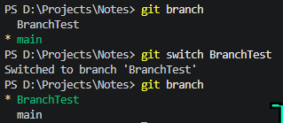
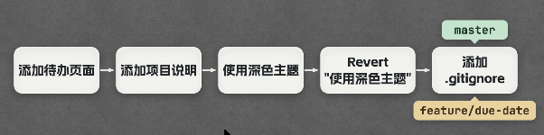
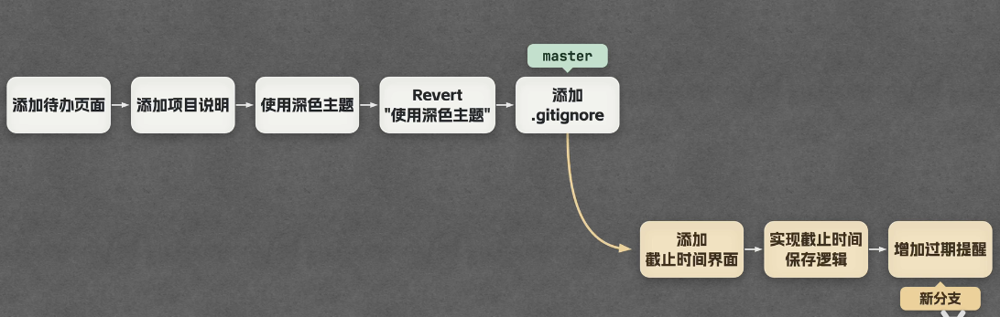
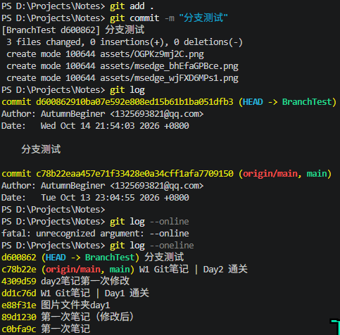
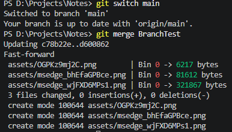
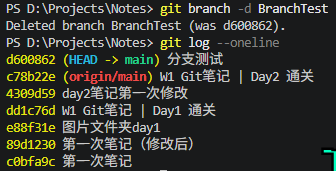

# Week 1 · Git 学习笔记

> **仓库路径**：`D:\Projects\Notes`
> **图片存放**：`./assets/`（相对路径引用，推送后不丢失）

## 常用命令合辑

下面这份按"使用频率 + 场景"分类，你可以直接存成 `Git命令速查.md` 放在笔记仓库里。带 ⭐ 的是你现阶段（Day 3）必须熟的，其余先眼熟，用到再查。

------

### 一、配置（一次性，配完就不用管）

```bash
git config --global user.name "你的名字"      # ⭐ 提交身份
git config --global user.email "你的邮箱"     # ⭐
git config --global init.defaultBranch main   # 新建仓库默认分支叫 main
git config --global core.autocrlf true        # Windows 换行符自动转换
git config --list                             # ⭐ 查看当前所有配置
git config --global --unset user.name         # 删除某项配置
```

> `--global` 对所有仓库生效；去掉它则只对当前仓库生效。

------

### 二、创建与初始化

```bash
git init                        # ⭐ 把当前文件夹变成 Git 仓库
git clone 仓库URL               # ⭐ 把远程仓库完整拉到本地
git clone 仓库URL 文件夹名      # 指定本地文件夹名
```

------

### 三、日常三步（最高频，天天用）

```bash
git status                      # ⭐ 看现在什么状态（永远先跑这个）
git add 文件名                  # ⭐ 把指定文件放进暂存区
git add .                       # ⭐ 把当前目录所有改动放进暂存区
git commit -m "说明"            # ⭐ 提交，-m 后面必须写清楚干了啥
git commit -am "说明"           # 已跟踪文件的改动，add+commit 一步搞定
git commit                      # 不带 -m，会打开编辑器写多行说明
```

**取消暂存（放错了想撤回）：**

```bash
git restore --staged 文件名     # Git 2.23+ 推荐
git reset HEAD 文件名           # 老版本写法，效果一样
```

------

### 四、查看历史与差异

```bash
git log                         # ⭐ 完整提交历史
git log --oneline               # ⭐ 每条一行，清爽
git log --oneline --graph       # 带分支图形，看分支走向很好用
git log --author="名字"         # 按作者筛选
git log --grep="关键词"         # 按提交说明搜索
git log -3                      # 只看最近 3 条
git diff                        # ⭐ 工作区 vs 暂存区（还没 add 的改动）
git diff --staged               # 暂存区 vs 上次提交（准备提交的内容）
git diff 分支A 分支B            # 两个分支的差异
git show 提交hash               # 看某一次提交具体改了什么
git blame 文件名                # 看每一行是谁、哪次提交写的
```

------

### 五、分支（Day 3 重点）

```bash
git branch                      # ⭐ 列出所有分支，当前分支前有 *
git branch 分支名               # ⭐ 新建分支（不切过去）
git branch -a                   # 连远程分支一起显示
git checkout 分支名             # ⭐ 切换分支
git checkout -b 分支名          # ⭐ 新建并立刻切过去（最常用）
git switch 分支名               # Git 2.23+ 专门用来切分支，语义更清晰
git switch -c 分支名            # 新建并切换（等价 checkout -b）
git branch -d 分支名            # ⭐ 删除已合并的分支（安全）
git branch -D 分支名            # 强制删除（没合并也删，慎用）
git branch -m 新名字            # 给当前分支改名
git branch -v                   # 显示每个分支最后一次提交
```

------

### 六、合并与冲突

```bash
git merge 分支名                # ⭐ 把指定分支合并进当前分支
git merge --abort               # 合并冲突时，放弃这次合并，回到合并前
```

**遇到冲突的处理流程：**

1. `git status` 看哪些文件冲突（显示 `both modified`）
2. 打开文件，找 `<<<<<<<` / `=======` / `>>>>>>>` 标记，手动留下正确内容、删掉标记
3. `git add 冲突文件`
4. `git commit -m "解决冲突"`

------

### 七、撤销与回退（⚠️ 危险区，看清再敲）

```bash
git restore 文件名              # ⭐ 丢弃工作区改动，恢复成上次提交的样子（不可恢复！）
git restore --source=分支名 文件名   # 从别的分支取某个文件过来
git checkout -- 文件名          # 老写法，同上
git commit --amend -m "新说明"  # ⭐ 修改最后一次提交（说明或内容），还没 push 时用
git reset --soft HEAD~1         # 撤销最后一次 commit，改动留在暂存区（安全）
git reset --mixed HEAD~1        # 撤销 commit，改动退回工作区（默认，较安全）
git reset --hard HEAD~1         # ⚠️ 撤销 commit 且丢弃所有改动，不可恢复
git revert 提交hash             # ⭐ 用"新提交"抵消某次提交（已 push 后推荐用这个）
git reflog                      # ⭐ 救命命令：记录所有 HEAD 移动，误删找回靠它
```

**误删分支/误 reset 后的找回：**

```bash
git reflog                      # 找到那个 hash
git checkout -b 恢复分支 那个hash
```

------

### 八、远程仓库

```bash
git remote -v                   # ⭐ 查看已绑定的远程
git remote add origin URL       # ⭐ 绑定远程仓库
git remote remove origin        # 解绑
git remote set-url origin 新URL # 改地址
git push                        # ⭐ 推送（已用 -u 绑定过就能这么简写）
git push -u origin 分支名       # ⭐ 首次推送并绑定
git push origin --delete 分支名 # 删除远程分支
git pull                        # ⭐ 拉取并合并远程更新
git pull --rebase               # 拉取但用 rebase 方式，历史更干净
git fetch                       # 只下载不合并，先看再决定（更安全）
git push --force-with-lease     # ⚠️ 覆盖远程（比 --force 安全，仍要谨慎）
```

------

### 九、暂存现场（Stash）

临时要切分支，但手上的改动还不想提交：

```bash
git stash                       # ⭐ 把当前改动临时收起来，工作区变干净
git stash list                  # 查看收了几份
git stash pop                   # ⭐ 取出最近一份并删除记录
git stash apply                 # 取出但保留记录
git stash drop                  # 删除某份
```

------

### 十、其他常用

```bash
git tag v1.0                    # 打标签（版本发布用）
git tag -a v1.0 -m "说明"       # 带说明的标签
git push origin --tags          # 把标签推上去
git clean -n                    # 预览会删掉哪些未跟踪文件（-n 只看不删）
git clean -fd                   # ⚠️ 真的删除未跟踪文件和文件夹
git rm 文件名                   # 从 Git 里删除文件（同时删本地）
git rm --cached 文件名          # 只让 Git 不再跟踪，本地文件保留（.gitignore 用得上）
git mv 旧名 新名                # 重命名并记录
git cherry-pick 提交hash        # 把某一次提交单独摘到当前分支
git rebase 分支名               # 变基，让历史成一条直线（进阶，练熟 merge 再学）
```

------

### 给你的「必背 12 条」

现阶段真正天天用的就这些，先把它练成肌肉记忆：

```bash
git status
git add .
git commit -m "说明"
git log --oneline
git diff
git branch
git checkout -b 分支名
git checkout main
git merge 分支名
git push
git pull
git restore --staged 文件名
```

------

### 三条安全守则（新手最容易出事的地方）

1. **切分支前先 git status**，有未提交改动先 commit 或 `git stash`，否则改动会跟着你跑到别的分支。
2. **--hard / -D / clean -fd / push --force 这四个，敲之前先想三秒**，它们删掉的东西 Git 不一定能帮你找回。
3. **已经 push 到远程的提交，别用 reset 改**，要用 `revert`（生成一次新提交来抵消），否则别人拉取会乱。

------

## Day 1 · Git 安装与首次 commit

### 1. 环境准备

#### 查看版本，确认安装成功

```bash
git --version
```

#### 建立目录 + 初始化仓库

```bash
mkdir Notes
cd Notes
git init
```

> **注意**：`git init` 会在目录里生成一个名为 `.git` 的隐藏文件夹（名字前面带一个英文句点）。它是整个仓库的核心，所有版本数据都存在这里。Windows 资源管理器默认不显示隐藏文件夹，需用 PowerShell 的 `ls -Force` 或开启"显示隐藏文件"才能看到。

#### 用 .md 文件记录笔记

初始化仓库后，可以在该目录里新建一个以 `.md` 结尾的文件（Markdown 格式）来记笔记，例如本次的 `W1-Git笔记.md`。Markdown 用 `#` 分级标题、用反引号包裹代码，VSCode 可直接预览。

------

### 2. 核心命令速查

| 命令                   | 作用                                        |
| ---------------------- | ------------------------------------------- |
| `git init`             | 把普通文件夹变成 Git 仓库                   |
| `git add`              | 把文件放进暂存区，告诉 Git "这个文件要存档" |
| `git commit -m "说明"` | 把暂存区的内容正式打包，生成一条提交记录    |
| `git log`              | 查看提交历史                                |

------

### 3. 三板斧：add → commit → log

```bash
git add W1-Git笔记.md
git commit -m "W1 Git笔记 | 首次提交"
git log
```

> **规律**：新增或修改内容后，重复上述过程即可。改一次 → add → commit，攒出一条条历史记录。

------

### 4. Git 仓库的三个区域（核心概念）

Git 仓库分为 **工作区、暂存区、版本库** 三部分：


1. **左侧「工作区（working tree）」**：你日常编辑的所有文件都在这里（如 index.html、script.js、style.css 等）。其中标了"已修改"的文件，说明你改过它但还没提交。
2. **`git add` 的作用——选择性挑选**：注意 `git add` 箭头指向的暂存区（stage）里，只有被挑选的几个文件，其余文件并没有进去。这就是"暂存区是草稿箱"的核心意义：**你只 add 想提交的部分，不是一股脑全交**。
3. **`git commit` 的作用——打包存档**：暂存区里的文件被打包成一个新版本提交（commit)。每一次 commit 都是一次**完整快照**，而不是在原版本上增量追加。

逐条对应：

- **工作区**：类似我们当前的项目文件夹，是你日常编辑文件的地方。
- **暂存区**：执行 `git add` 后文件进入的区域，相当于"准备提交的草稿箱"。
- **版本库**：执行 `git commit` 后的内容正式存档的位置，里面保存着所有的**提交历史**。

> **重要辨析**：截图里暂存区画成了一个**带边框的独立框**，容易让人误以为它是某个真实的文件夹。实际上暂存区**不是一个你可以打开的文件夹**，它是 `.git` 内部维护的一张"清单表"（叫 `index` 文件），记录"哪些文件的哪些改动被我选中了"。你不需要找到它，只需要记住 `git add` 就是把文件信息登记到这张表里。

当项目里有多个文件时，用 `git add` 把需要提交的文件放进暂存区；等暂存区的文件全部整理好，再用 `git commit` 统一提交，作为一个修改的整体版本。

------

### 5. 首次提交全流程详解

#### 状态检查：待提交文件已进入暂存区


执行 `git add .\W1-Git笔记.md` 后跑一次 `git status`，输出类似：

```text
On branch main

No commits yet

Changes to be committed:
  (use "git rm --cached <file>..." to unstage)
        new file:   "W1-Git\347\254\224\350\256\260.md"
```

**从这段输出能读出 4 件事：**

1. `On branch main` → 当前在 `main` 分支。
2. `No commits yet` → **这个仓库还从未提交过**，这是第一条 commit 之前特有的提示。以后再跑 `git status` 就不会有这行了。
3. `Changes to be committed` → 文件已经成功进入暂存区，下一步可以 commit。
4. `new file: "W1-Git\347\254..."` → 这是 `W1-Git笔记.md` 的 UTF-8 字节编码显示（`\347\254...` 就是"笔记"二字的字节序列），说明 Git 识别到它是一个**全新的文件**（之前从未被跟踪过）。

> **关键区别**：以后修改已有文件再 add，这里会显示 `modified:` 而不是 `new file:`。`new file` 只出现在文件第一次被 add 时。

#### 配置提交身份（用户名 + 邮箱）


提交前告诉 Git 自己的用户名和邮箱，供 commit 时记录作者。**Git 不做真实性校验**，只是把它写进提交记录里。

```bash
git config --global user.name "AutumnBeginer"
git config --global user.email "1325693821@qq.com"
```

配完后可以用下面的命令验证是否生效：

```bash
git config user.name
git config user.email
```

应输出 `AutumnBeginer` 和 `1325693821@qq.com`。

> 说明一：带 `--global` 的配置是**一次性**的，写好之后对所有仓库生效，并不是每次提交前都要重新配置。第一次用 Git 时配好即可。
> 说明二：`git config --global ...` 执行后**没有任何终端输出是正常的**，Git 不会告诉你"配置成功"，只要没报错就说明写进去了。

#### 执行提交


使用 `git commit -m "说明"`，其中 `-m` 代表 message，用来标注这次 commit 做了什么、改了什么，方便日后查看历史。

执行 `git commit -m "第一次笔记"` 后输出：

```text
[main (root-commit) cb9fa9c] 第一次笔记
 1 file changed, 35 insertions(+)
 create mode 100644 "W1-Git\347\254\224\350\256\260.md"
```

**逐行翻译：**

- `[main` → 提交发生在 `main` 分支上
- `(root-commit)` → **这是根提交**，即仓库历史上的第一条 commit。以后再提交就不会有这行标注了
- `cb9fa9c]` → 本次提交 commit hash 的**前 7 位**（完整 hash 是 40 位十六进制字符）。以后回退/撤销时靠这个短 hash 定位具体哪一条
- `第一次笔记` → 你写的 commit message
- `1 file changed` → 本次提交涉及 1 个文件
- `35 insertions(+)` → 共新增了 35 行内容（整篇笔记是新写的，所以全是插入，没有删除）
- `create mode 100644` → Git 记录的文件权限模式，`100644` 表示"普通文件，所有者可读写，其他人只读"，不需要你改，Git 自动处理

> **判断技巧**：看到 `(root-commit)` 说明这是仓库的"第一粒种子"，从 0 到 1 的里程碑。以后的提交只会显示类似 `[main abc1234]`，不再有 `root-commit` 标注。

#### 查看历史


紧接着输入 `git log` 查看 commit 历史，输出：

```text
commit cb9fa9c6e545c2d44a30c7db85321552efea2598 (HEAD -> main)
Author: AutumnBeginer <1325693821@qq.com>
Date:   Mon Oct 12 19:16:05 2026 +0800

    第一次笔记
```

**逐行翻译：**

- `commit cb9fa9c...` → 完整 40 位 hash。上面 commit 输出里看到的 `cb9fa9c` 就是它的前 7 位缩略版
- `(HEAD -> main)` → **HEAD 指向 main 分支**，且 main 分支的"最新位置"就在这条 commit 上。以后 commit 越多，HEAD 会跟着最新的 commit 一起往前走
- `Author: AutumnBeginer <1325693821@qq.com>` → **证明身份配置生效了**。如果这里是旧用户名/邮箱，说明 `git config` 没配对
- `Date: Mon Oct 12 19:16:05 2026 +0800` → 提交时间，`+0800` 表示东八区（北京时间）
- 缩进的 `第一次笔记` → commit message

> **对比验证**：把这里的 Author 邮箱和 `git config user.email` 的输出对照，一致就说明 Day 1 的身份配置彻底成功了，以后每次 commit 都会带上这个身份。

注：可以在修改了文件但还没有执行`git add`操作时，使用`git diff`命令查看改动有哪些（工作区VS暂存区），如果已经add，则可以使用`git diff --staged`来比较暂存区文件和上次commit版本的差异，而`git diff HEAD`可以一次性检查所有还未commit的工作（工作区VS最后一次commit版本）


------

### 6. Day 1 · 三个关键问题总结

#### 1. 仓库到底是个什么东西

**一句话**：普通文件夹变成"仓库"，就是因为它里面多了一个 `.git` 文件夹。`.git` 就是 Git 的"大脑 + 档案柜"，所有版本信息都存在它里面，而不是存在笔记文件里。

**凭什么它一出现就变成仓库了？** 因为 Git 判断"当前目录是不是仓库"，靠的就是**向上找 `.git`**：

- `git init` 干的事，本质就是在当前目录**造一个 `.git` 文件夹**，里面预先放好了空的档案结构（分支指针、对象库、配置等）。
- 此后任何 `git` 命令，都会先在当前目录找 `.git`，找不到就一层层往父目录找，找到就用它。

这正好解释了第 1 轮踩的坑：在 `learning-log` 里敲 `git status`，却看到 `..test01.py` 这些路径——那是因为 `learning-log` 自己**没有** `.git`，Git 往上找到了 `D:\Projects\.git`，于是把你当成了那个大仓库里的一员。删掉父目录的 `.git`、在 `Notes` 里重新 `git init`，`Notes` 才第一次拥有了属于自己的 `.git`，从此独立。

> 所以"仓库 = 一个带 `.git` 的普通文件夹"。`.git` 是隐藏的，是因为它是给机器看的内部档案，平时不该误碰。

#### 2. add / commit 各自在干嘛，为什么要中间夹一个暂存区

**三层流动关系**（记住这个方向就够）：

```text
工作区  --git add-->  暂存区  --git commit-->  本地仓库
(你正在编辑的)      (草稿箱/待提交清单)       (永久存档，带版本号)
```

- **工作区**：你直接用 VSCode 打开、能看能改的那些文件本身。
- **`git add` 做的事**：把"我这次想把哪些改动纳入下一版"挑选出来，拍个快照放进暂存区。它是**选择性**的动作——你可以只 add 一部分文件。
- **`git commit` 做的事**：把暂存区里这一堆东西**打包成一条永久记录**，生成一个 commit（带唯一 hash、作者、时间、说明）。commit 之后这条记录就再也动不了了，要改只能再提新的。

**为什么非要有暂存区，直接提交不行吗？** 这是 Git 设计上很聪明的一点，核心目的是**让你能"攒一批相关改动，一次提交"**：

- 假设你同时改了 3 件事：修了笔记错别字、补了一段命令解释、又顺手调了图片路径。如果"改完即提交"，这 3 件事会被迫挤进同一条 commit，历史会糊成一团，以后想回退某一件都做不到。
- 有了暂存区，你可以**先只 add 错别字那部分 → commit 一条**；再 add 命令解释 → 再 commit 一条。每次提交都是"一个干净、自洽的小单元"。
- 也就是说：**暂存区是"提交前的取景框"**，让你决定"这一版到底包含什么"，而不是工作区里乱七八糟改动的全量快照。

> 一个帮助理解的比喻：工作区是你的"书桌"（东西摊得到处都是），暂存区是你"决定要交上去的那一摞纸"，commit 是"盖了日期章正式归档的那一份"。你不必把整张书桌都归档，只交那一摞。

#### 3. git status 为什么值得随时敲

**一句话**：`git status` 是 Git 的"体检报告 / GPS 定位"——它不改变任何东西，只回答一个问题：**我现在到底站在哪、手上有哪些活儿没处理完。**

跑一次它，你能从输出里读出这几件事：

1. **当前在哪个分支**（`On branch main`）。以后开分支干活时，这条尤其重要，能防止"以为在 A 分支其实还在 main 上乱改"。
2. **哪些文件被改动、但还没进暂存区**（"Changes not staged for commit"）→ 提示你该 `git add` 了。
3. **哪些文件已经进了暂存区、等着被提交**（"Changes to be committed"）→ 提示你 `git commit` 会把它们打包走。
4. **哪些是全新、Git 还没开始跟踪的文件**（"Untracked files"）→ 比如刚在 VSCode 新建但没保存/没 add 的笔记。"建了文件 git status 看不到"的困惑，本质就是这一栏：要么没保存，要么没 add。
5. （冲突时）哪些文件**有冲突需要你手动解决**。

**为什么"值得随时敲"？** 因为它是你判断"下一步该敲什么命令"的依据，而不是凭记忆瞎猜：

- 看到 `Untracked` → 该 `git add`；
- 看到 `not staged` → 改动还没被纳入本次提交，要不要 add；
- 看到 `to be committed` → 可以直接 `git commit` 了；
- 什么都没有、显示 `nothing to commit, working tree clean` → 说明改动已经全部安全存档，可以放心干下一件事。

------

## 补充：命令行环境对比

### Cmd vs PowerShell

| 对比维度     | Cmd（命令提示符）                      | PowerShell                                                   |
| ------------ | -------------------------------------- | ------------------------------------------------------------ |
| **底层**     | 传统命令行，基于 DOS，处理纯文本       | 基于 .NET 框架，处理结构化对象                               |
| **命令风格** | 少量固定命令（dir、cd、copy）          | 动词-名词命名（Get-ChildItem），命令丰富且可扩展，兼容多数 Cmd 命令作别名 |
| **管道**     | 传递文本，后续命令需自行解析           | 传递对象，可直接访问属性/方法，无需解析                      |
| **脚本能力** | 批处理（.bat）功能简单，缺现代编程特性 | 完整编程语言（函数、类、异常、模块），适合复杂自动化         |
| **管理范围** | 文件系统及基本操作                     | 全 Windows 生态（注册表、服务、IIS、Azure 等），可通过模块扩展 |
| **适用场景** | 日常简单操作（查看目录、复制文件）     | 系统管理、批量运维、脚本自动化                               |

> **简单选**：轻量操作用 Cmd，复杂自动化用 PowerShell。

### VS Code 集成终端

**本质**：VS Code 内嵌的系统 shell 界面（非独立 shell），实际运行的是系统已安装的 shell（如 PowerShell、Cmd、Git Bash、WSL 等）。

**特点**：

- 与编辑器同窗口，免切换
- 默认从当前项目根目录启动
- 可与任务、调试、Git、扩展联动
- 支持多标签（同时开不同 shell）

**如何打开**：

- 快捷键：`` Ctrl + ` ``（反引号）
- 新建终端：`Ctrl+Shift+`（Mac 为 `Cmd+Shift+`）
- 菜单：查看 → 终端

**修改默认 shell**：

1. 命令面板法：`Ctrl+Shift+P` → `Terminal: Select Default Profile` → 选所需 shell

2. 设置法（settings.json）：

   ```json
   "terminal.integrated.profiles.windows": {
     "Command Prompt": { "path": "..." },
     "PowerShell": { "path": "..." }
   },
   "terminal.integrated.defaultProfile.windows": "Command Prompt"
   ```

   可针对工作区单独配置。

**注意事项**：

- 集成终端权限继承 VS Code，如需管理员权限需另开外部终端或使用 `runas`
- 若终端闪退，检查 shell 是否安装、启动目录是否存在、启动脚本是否有误

### Bash 语言简介

Bash 是 Linux/macOS 下的"命令行母语"，擅长用简洁的文本流管道完成系统管理和自动化任务。在 Windows 上可通过 WSL 或 Git Bash 获得类似的体验。

------

## Day 2 · 推送 GitHub

### 1. commit 信息规范

commit 信息为什么要写成 `W1 主题 | 进度` 这种格式？这不是 Git 的语法要求——`git commit -m "随便写点啥"` 也能提交成功。它图的是**人**，不是机器。核心目的有三个：

**① 让 `git log` 一眼能扫。** 以后笔记越记越多、commit 几十条时，`git log` 是一长串列表。有统一格式的话，眼睛能立刻按"周次 / 主题"定位：

```text
W1 Git笔记 | 首次提交
W1 Git笔记 | 补充踩坑记录
W1 Git笔记 | Day1 通关
W2 分支 | 学会开 feature 分支
```

没有格式的话就是"改了一下""又改了""test"——回头你自己都认不出哪条是哪条。

**② `|` 把"定位"和"内容"分开。**

- 竖线左边 `W1 Git笔记`：**这是什么**（周期 + 文件/主题），相当于"文件名 + 章节"。
- 竖线右边 `补充踩坑记录`：**这次具体干了啥**，一句话描述这次改动的动作。

这样切分后，左边保持稳定（同一篇笔记的 commit 前缀都一样），右边每次都不同，`git log` 里就能看出"同一主题下我推进了哪几步"。

**③ 方便日后回退/筛选。** Day 4 要学"回退与撤销"，那时需要从历史里精确挑出某一条 commit。信息规范时，可以用关键词搜：

```bash
git log --grep="补充踩坑"
```

乱写就搜不到。

> 一句话：commit 信息是写**给未来的自己和同事看的日志标题**，不是写给 Git 解析的。固定成 `范围 | 动作`，就是为了让历史记录像目录一样可扫、可搜、可回退。

### 2. SSH 配置（推荐方案）

**为什么选 SSH？** 配一次密钥，后续所有 `git push`、`git pull` 都不需要再输任何密码或 token，且比 HTTPS 更安全（私钥留在本地，公钥交给 GitHub）。绝大多数开源项目和专业开发者都默认使用 SSH。

#### 第一步：生成 SSH 密钥

打开 **Git Bash**（或 VS Code 终端，确保是 Git Bash 而非 cmd/PowerShell），执行：

```bash
ssh-keygen -t ed25519 -C "你的GitHub邮箱"
```

- 第一个回车：接受默认保存路径 `C:\Users\你的用户名\.ssh\id_ed25519`
- 第二、三个回车：密码短语留空（避免每次使用都要输密码）
- 完成后会显示指纹和随机图案，暂时不必深究

生成的两个文件：

- `id_ed25519` —— **私钥**，绝不可泄露
- `id_ed25519.pub` —— **公钥**，需要添加到 GitHub


#### 第二步：将公钥添加到 GitHub

1. 用记事本打开 `id_ed25519.pub`，全选复制里面的内容。
2. 浏览器登录 GitHub，点击右上角头像 → **Settings**。
3. 左侧菜单选择 **SSH and GPG keys** → **New SSH key**。
4. Title 任意填写（如 `My PC`），Key 粘贴刚才复制的内容 → **Add SSH key**。


#### 第三步：测试连接

终端执行：

```bash
ssh -T git@github.com
```

第一次会提示 `Are you sure you want to continue connecting?`，输入 `yes` 回车。看到类似以下输出即成功：

```text
Hi 你的用户名! You've successfully authenticated, but GitHub does not provide shell access.
```


### 3. 关联远程仓库

在 GitHub 上**建一个空的远程仓库**（不要勾选 README、.gitignore 或 license，保持全空，否则首次推送会和本地冲突）。

创建成功后，页面会显示推送指南。因为我们选择 SSH，所以复制 SSH 格式的地址：`git@github.com:AutumnBeginer/Notes.git`

在本地 `Notes` 目录的终端中执行：

```bash
git remote add origin git@github.com:AutumnBeginer/Notes.git
```

**这条命令做了什么？** 把远程仓库地址 `git@github.com:AutumnBeginer/Notes.git` 起了一个别名 `origin`，并将本地仓库与这个远程地址关联起来。以后 `origin` 就代表这个远程仓库。

> **如果之前已经关联过 `origin`**（例如先用 HTTPS 试过），再次执行 `git remote add` 会报错 `error: remote origin already exists`。此时应改用 `set-url` 修改地址：
>
> ```bash
> git remote set-url origin git@github.com:AutumnBeginer/Notes.git
> ```

验证关联是否成功：

```bash
git remote -v
```

输出应显示两行（fetch 和 push），均指向你的 SSH 地址，如下图：


### 4. 推送操作详解

#### 确认当前分支名

执行 `git status`，观察第一行。如果显示 `On branch main`，则无需重命名；如果显示 `On branch master`，则需要执行：

```bash
git branch -M main
```

`-M` 是强制重命名，将 `master` 改为 `main`（GitHub 推荐的默认主分支名）。

#### 首次推送（带 `-u`）

```bash
git push -u origin main
```

**`-u` 是什么？** 是 `--set-upstream` 的缩写，作用：**把"本地 main 分支"和"远程 origin 的 main 分支"绑成默认搭档**。

- 这条命令干了两件事：① 把代码推上去（把你本地仓库中**所有远程仓库还没有的 commit（提交记录）**打包上传到 GitHub）；② **记住**"以后我在本地 main 上，push/pull 默认就对着 origin 的 main"。
- 之后推送就可以直接用 `git push` 和 `git pull`，无需再加参数。

**如果没有 `-u` 会怎样？** 每次推送都必须写全 `git push origin main`，且首次 `git pull` 会提示"指定要合并哪个远程分支"。

> 一句话：`-u` 是"**首次推送时顺便认个干亲**"，绑好之后 push/pull 就能省掉后面那串参数。Day 2 第一次推送，务必带上 `-u`。

下面为执行截图：


```bash
Enumerating objects: 29, done.：Git 开始计算需要推送的对象（文件改动），共找到 29 个。

Counting objects: 100% (29/29), done.：统计完成。

Delta compression using up to 16 threads：Git 动用电脑的多线程（16核）对改动进行增量压缩，目的是减少网络传输的数据量。

Compressing objects: 100% (27/27), done.：压缩完成。

Writing objects: 100% (29/29), 298.72 KiB | 454.00 KiB/s, done.：正在把压缩后的数据写入（上传）到远程仓库，显示了总大小和上传速度。

Total 29 (delta 3), reused 0 (delta 0), pack-reused 0：推送的总体统计（包含3个差异对象）。

remote: Resolving deltas: 100% (3/3), done.：remote: 代表这是GitHub服务器返回的信息，表示服务器正在解压并重组你的改动。

To github.com:AutumnBeginer/Notes.git：推送的目标远程仓库地址。

* [new branch] main -> main：因为你是首次推送，GitHub 上原本没有 main 分支，这句话表示成功在远程创建了 main 分支，并把本地的 main 推了上去。

branch 'main' set up to track 'origin/main'.：这就是 -u 参数的功劳！​ 表示本地 main 分支和远程 origin/main 分支绑定成功。以后你只需要输入 git push 或 git pull，Git 就会自动找对地方，不用再写全 origin main 了。
```

* 现在刷新Github页面，就可以看到远程仓库已经更新：

  

* 点击时钟图标（标注有5commits)，可以看到历史commit记录：

#### 完整操作流程（从修改笔记到推送到 GitHub）

```bash
# 1. 将所有改动加入暂存区
git add .

# 2. 提交到本地仓库（生成一个本地版本）
git commit -m "W1 GitHub远程 | 完成笔记更新"

# 3. 推送到 GitHub（将本地版本上传到云端）
git push -u origin main
```

**关键理解**：

- `git add` 和 `git commit` 是**完全在本地执行**的操作，与网络无关，即使断网也能执行。
- `git push` 是**唯一涉及网络传输**的命令，它将本地已提交的 commit 上传到远程仓库。

### 5. 关键概念澄清

#### origin 是什么？

`origin` 是远程仓库的**默认别名（小名）**。

- **为什么叫 origin？** 英文意思是"源头、起源"。从 GitHub 克隆仓库时，Git 会自动把这个远程仓库的名字设为 `origin`。它是一个约定俗成的名称。
- **它的作用是什么？** 为了偷懒和省事。没有别名时每次推送都要输完整地址，有了 `origin` 只需写 `git push origin main`。
- **必须叫 origin 吗？** 不是必须的，你可以改成任何名字（如 `github`、`backup`），甚至一个项目可以关联多个远程仓库。但为了和全网教程保持一致，**强烈建议新手就叫 origin**。

#### SSH 认证原理

SSH key 在本地生成，分为私钥和公钥：

- **私钥**存在本地，绝不可泄露。
- **公钥**发给 GitHub。

每次向 GitHub 传输代码时，本地私钥会生成一个验证文件（签名）一并传给 GitHub，GitHub 用公钥验证该签名是否由你的私钥生成，从而确认身份。

#### 推送前后状态变化

- **关联后、推送前**：本地仓库与 GitHub 仓库已建立连接，但代码仍在本地，GitHub 上仍是空仓库。
- **推送后**：本地所有已提交的 commit 被上传到 GitHub，可以在网页上看到文件和历史记录。

### 6. Day 2 · 三个关键问题总结

 1. **`git push` 到底同步了什么？** 

**一句话**：同步的是**本地所有远程没有的 commit 历史**，不只是最后一次修改。

- `git push` 会把本地仓库中**从上次推送以来产生的所有新 commit** 打包上传到 GitHub 
- 推送完成后，本地和远程的提交历史**完全一致** 
- GitHub 文件列表页默认只显示**最新一次** commit 的信息，但点击 `5 Commits` 链接就能看到完整的提交历史 

> **误区纠正**：你之前担心“之前的 commit 记录是否还在本地”，答案是**全部已上传**。`git push` 不是只传最后一次，而是传“本地比远程多的所有东西”。

 2. **SSH 为什么比 HTTPS 更适合你？** 

**一句话**：配一次密钥，终身免密推送，且更安全。

| 对比维度 | HTTPS + PAT                          | SSH                              |
| -------- | ------------------------------------ | -------------------------------- |
| 首次配置 | 生成 token 并复制粘贴                | 生成密钥对 + 上传公钥            |
| 日常使用 | 需 Git Credential Manager 缓存 token | 完全免密，公私钥自动配对         |
| 安全性   | token 是字符串，泄露=仓库失控        | 私钥在本地，公钥在 GitHub        |
| 跨设备   | 每台设备都要重新生成 token           | 每台设备单独生成密钥对，各配各的 |

**对你而言**：你是长期学习者，每天都要 commit + push，SSH 的“配一次，永久免密”是最省心的选择。你今天已经配好了，未来所有 push 都不会再被认证问题卡住。

 3. **`-u` 参数到底做了什么？** 

**一句话**：`-u` = 首次推送时绑定“本地 main”和“远程 origin/main”的默认关系。

- **绑定前**：每次推送必须写全 `git push origin main`，拉取必须写 `git pull origin main` 
- **绑定后**：直接 `git push` 和 `git pull` 即可，Git 会自动找到绑定的远程分支 
- **验证方式**：执行 `git branch -vv`，会看到 `main [origin/main]` 字样，表示绑定成功 

> **比喻**：`-u` 就像第一次去朋友家时存了他的地址到通讯录。以后再说“去他家”，手机自动导航，不用再念一遍门牌号。

------

> **Day 2 完成标志**：刷新 GitHub 仓库页面，能看到你的笔记文件和 commit 记录。以后每次修改只需 `git add` → `git commit` → `git push` 即可同步到云端。
------

## Day 3 · 分支与合并

### 1. 为什么需要分支

想象这样一个场景：

一个图书馆管理系统，已经实现了用户注册登录、图书借阅登记等功能。此时你要新增一个"归还截止时间"功能，它分为三个模块：截止时间设置界面、超时判断逻辑、超时提醒。如果你刚写完"截止时间界面"就直接在 `main` 分支上 `commit` + `push`，那么用户点进这个界面却发现后端逻辑还没接上，功能并不完整——`main` 分支上的系统因此处于"不稳定、甚至不可用"的状态。这在真实开发中是无法接受的。

我们要求 **`main` 分支上的代码始终是稳定、可用的**，于是就有了分支（branch）：

先基于当前 `main` 创建一个独立分支，专门开发这个新功能，所有相关 commit 都提交到新分支上，开发过程完全不影响主分支。等功能测试稳定后，再把新分支**合并**回 `main`。

> **一句话**：分支就是"从主线复制出一条平行轨道，在支线上的折腾都不影响主线，满意了再并轨回去"。

------

### 2. 创建分支

```bash
git branch 分支名          # 新建分支（不切换过去）
git branch                 # 不带分支名，列出所有分支，当前分支前有 *
git switch 分支名          # 切换到指定分支
git switch -c 分支名       # 新建并立刻切过去（c = create，最常用）
```

如下图所示，创建并切换后用 `git branch` 查看，带 `*` 的就是当前所在分支：



更方便的写法是 `git switch -c 分支名`：一步完成"创建分支 + 切换过去"。

------

### 3. 分支的本质：一个会移动的标签（指针）

刚切到新分支时，仓库内容看起来没有任何变化——因为新分支此刻和 `main` 指向**同一个 commit**。要真正理解分支，记住它的工作方式：

把项目的开发过程按功能切成小块，用箭头从左到右连起来，表示各功能的实现顺序：



- `main` 标签和新分支标签**一开始都指向同一个 commit**（最后一个已完成的功能）。
- **你在哪个分支上执行 `commit`，哪个分支的标签就自动向前移动、指向这条新 commit**；其他分支的标签原地不动。
- 于是新功能只被新分支的标签跟踪，`main` 仍停在原来的位置——这就是"开发新功能不影响主分支"的底层原因。



> **纠正一个常见误解**：并不是"切到哪个分支，该分支标签就指向最新 commit"。切换分支只是移动 `HEAD`（你当前的位置标记），**不会自动前进任何分支的标签**。真正让某个分支标签前进的，只有"在该分支上做一次 `commit`"这个动作。

**对应到实际操作**：在新分支上 commit 后，用 `git log --oneline` 把历史压缩成一行查看——



可以看到 `main` 还停在 Day 2 那条 commit 上，而新的 commit 在 `BranchTest` 分支这一侧。

------

### 4. 合并分支

功能开发完毕、测试稳定，就可以把新分支合并回 `main` 正式上线。**合并要在"目标分支"上发起**——也就是先切回 `main`，再把分支并进来：

```bash
git switch main            # 1. 先切回主分支（合并的目标）
git merge BranchTest       # 2. 把 BranchTest 合并进当前所在的 main
```



合并后，`main` 标签移动到与分支相同的 commit 上，新功能正式进入主线。此时分支已完成使命，可以删除：

```bash
git branch -d BranchTest   # 删除已合并的分支（-d 安全，未合并会拒绝）
git branch -D BranchTest   # 强制删除（连未合并的也删，慎用）
```



删除后，`git branch` 里就只剩 `main` 一条主线了。

------

### 5. 合并冲突

上面的合并之所以顺利，是因为 `main` 在分支开发期间**没有动过同一处代码**，Git 只需把标签往前一移即可（这种情况叫 **fast-forward 快进合并**）。

但当下述情况发生，Git 无法判断该保留谁，就会产生**冲突（conflict）**：

- 同一段代码，`main` 和新分支**各自做了不同的修改**，合并时两份改动撞在了一起。
- 典型场景：`main` 上在"开始"按钮右边加了一个"结束"按钮，而新分支在同一位置加了"暂停"按钮——同一个地方要放两个不同内容，Git 无法替你决定，必须人工裁决。

> 冲突不是"出错"，而是 Git 诚实地告诉你"这里有两份改动，请你来定"。现阶段先理解它何时发生即可，等真正遇到再逐项练习手动解决：打开冲突文件找到 `<<<<<<<` / `=======` / `>>>>>>>` 标记，留下正确内容删掉标记，再 `git add` + `git commit`。

------

### 6. Day 3 · 三个关键问题总结

#### 1. 分支到底是什么？切换分支时，硬盘上的文件会发生什么？

**一句话**：分支只是一个指向某条 commit 的可移动标签；切换分支不会改内容，而是把"工作区那一份文件"替换成目标分支所指向的状态。

- 磁盘上同一份文件**永远只有一个**，不存在"main 版"和"分支版"两个文件。
- 你在 `feature` 分支写了新笔记并 commit，切回 `main` 时，`main` 没有这条记录，Git 就把该文件从工作区**拿走**（看起来"消失"，其实安全躺在 `feature` 分支和 `.git` 里）；再切回 `feature`，它又完整出现。
- 因此养成习惯：**改哪条线的笔记，先 `git status` 确认自己在哪个分支。**

#### 2. 合并时为什么必须先切回 main？合并的本质是什么？

**一句话**：`git merge` 是把"指定分支"并进"你当前所在的分支"，所以想并进 `main`，就必须先站在 `main` 上。

- `git switch main` → `git merge BranchTest`：方向是"把 BranchTest 拉进 main"，而不是反过来。
- 若在 BranchTest 上执行 `git merge main`，就变成"把 main 拉进 BranchTest"，主线依旧没更新。
- 当 `main` 在分叉后没改动，合并只是把 `main` 标签前移（fast-forward）；当两边都改过，则生成一条"合并 commit"把两条线缝合在一起。

#### 3. 什么时候会出现冲突？Git 为什么不能自动解决？

**一句话**：当两条线修改了**同一处内容**，Git 无法判断保留谁的版本，只能交给人来裁决。

- 各改各的文件、或同一文件的不同区域 → Git 能自动合并，无冲突。
- 同一文件的同一行/同一位置被两边改成不同结果 → 冲突，需手动处理标记块后 `add` + `commit`。
- 这正是分支并行开发的代价与收益：Git 把"合并的决定权"交给你，换来了多人、多线并行开发的可能性。

------

> **Day 3 完成标志**：能在本地完整跑通"建分支 → 切过去改文件 → commit → 切回 `main` → merge → 删分支"整条流程，并说得清"切换分支时文件为何会暂时消失""合并为何要先切回目标分支"。把这份笔记 `add` → `commit` → `push`，Day 3 通关。

## Day 4 · 回滚（撤销与恢复）

> **Day 4 目标**：掌握"改动已经 commit 后如何回滚"这件事。区分 `git restore`（丢弃工作区改动）、`git reset`（改写历史）与 `git revert`（反向提交）三者的适用场景，并学会用 `git reflog` 找回误删的提交。

### 1. 先分清"改动在哪个区"

回滚前第一步，永远是 `git status` 看清改动现在处于哪个阶段——**不同阶段的撤销方式完全不同**：

|改动所在位置|含义|撤销方式|
|---|---|---|
|**工作区**（unstaged）|改了文件但还没 `git add`|`git restore 文件名`|
|**暂存区**（staged）|已 `git add` 但还没 `git commit`|`git restore --staged 文件名`|
|**已提交**（committed）|已经 `git commit`|`git revert`（安全）或 `git reset`（改历史）|

举个实际场景：修改笔记并保存后跑 `git status`：


依次解读：

1. **`On branch main`** → 当前在 `main` 分支上工作。
   
2. **`Your branch is up to date with 'origin/main'.`** → 本地 `main` 与远程 `origin/main` 完全同步，没有新提交。
   
3. **`Changes not staged for commit:`** → 修改了文件，但**还没暂存**（没进暂存区）。下面列出了具体文件：
   
    - `modified: "W1-Git\347\254\224\350\256\260.md"` → 这就是 `W1-Git笔记.md` 的 UTF-8 编码显示，说明它已被修改。
    
4. **`no changes added to commit`** → 目前没有任何内容进入暂存区，还没准备好提交。
   
5. **括号里的两条提示**：
   
    - `git add <file>...` → 想提交这次修改，就先把它 `add` 进暂存区。
      
    - `git restore <file>...` → 不想保留这次修改，用它恢复到上次提交时的状态。
      

> 提示里的文件名是 `W1-Git笔记.md`（首字母 W），以后输命令时务必写对，别打成 `M1`。

### 2. 三种撤销手段（按危险程度排序）

#### 工作区：`git restore`（改动未暂存）

git restore 文件名        # 只丢弃指定文件的改动  
git restore .             # 丢弃工作区全部改动

- 把工作区文件恢复到**上次提交（HEAD）时的样子**。
  
- 这是**不可恢复**的操作：文件里手打的改动会直接消失，Git 帮不了你。
  
- 只想撤销某几个文件就写文件名，别随手敲 `git restore .`。
  

#### 暂存区：`git restore --staged`（已 add 但未 commit）

git restore --staged 文件名

- 把文件从**暂存区踢回工作区**，文件本身在工作区的修改**不会丢失**。
  
- Git 2.23+ 推荐写法；老版本等价写法是 `git reset HEAD 文件名`。
  

#### 已提交：`git revert` 与 `git reset`（两条完全不同的思路）

改动一旦 commit，回滚就分两种思路——**加一条反向提交**还是**把指针往后挪**。这是 Day 4 最核心的区分。

### 3. `git revert` —— 安全地撤销（推荐）

`git revert` **不会删除旧 commit**，而是生成一个**新的反向提交**，把目标提交做的改动"反着做一遍"，让文件内容回到目标提交之前的状态。

举个例子：

|提交|做了什么|文件内容|
|---|---|---|
|C1|写了 `A`|`A`|
|C2|加了 `B`|`A B`|
|C3|revert C2|`A`|

C3 之后，文件内容看起来和 C1 一样，但 Git 历史仍然是：

C1 -> C2 -> C3

C2 没有被删掉，只是被 C3 "反向抵消"了。所以更准确的说法是：

> **`git revert <提交>` 会保留原提交，并创建一个新提交，让文件内容恢复到目标提交之前的状态。** 它不用抹掉旧记录，而是用新提交"反着做一遍"。

这也正是它**适合已经 push 到远程**的原因——它没有改写历史，别人拉取时不会冲突。用法：

git revert <提交hash>      # 撤销指定提交  
git revert HEAD            # 撤销最近一次提交

### 4. `git reset` —— 彻底抹除（危险，改写历史）

`reset` 与 `revert` 最大的不同在于：**`revert` 是"加一条反向提交"，`reset` 是"把分支指针往后挪"**。

#### 本质区别

|对比点|`git revert`|`git reset`|
|---|---|---|
|原理|新建一个提交，反向抵消之前的修改|移动 HEAD 指针，让分支回退到更早的提交|
|历史记录|不删除旧提交，历史更完整|被回退的提交会从当前历史中消失|
|安全性|高，适合已 push 到远程的情况|低，适合本地未推送的提交|
|对远程影响|正常 `git push` 即可|若已推送需 `git push -f`，容易影响协作者|

#### 用笔记场景理解

假设已提交：

C1: 初始笔记  
C2: 添加"Git reset 学习笔记"

- 运行 `git revert HEAD` → 生成 `C1 -> C2 -> C3(revert C2)`，C2 还在，C3 把它抵消。
  
- 运行 `git reset --hard HEAD~1` → 历史变成 `C1`，**C2 从当前分支历史里消失了**。
  

#### `reset` 的三种强度

```bash
git reset --soft  HEAD~1    # 撤销 commit，修改保留在暂存区（最温和）
git reset --mixed HEAD~1    # 撤销 commit 和 add，修改保留在工作区（默认，可省略 --mixed）  
git reset --hard  HEAD~1    # 彻底回退，连工作区修改也一起丢弃（最危险，不可恢复）
```

#### 怎么选

- **还没 push 到远程**：可以用 `git reset`，尤其 `--soft` / `--mixed`，灵活调整提交。
  
- **已经 push 到远程 / 别人可能已经拉取**：用 `git revert`，别随便 `reset --hard`。
  

### 5. `HEAD~n` 到底是什么

|部分|含义|
|---|---|
|`HEAD`|当前分支的最新提交（一个指针）|
|`~`|沿着提交历史往前回溯|
|`n`|回溯 n 步|

所以 **`HEAD~1` = 当前提交的父提交（上一次 commit）**。

|写法|含义|
|---|---|
|`HEAD~1`|上 1 次提交|
|`HEAD~2`|上 2 次提交|
|`HEAD~5`|上 5 次提交|

常见用法：

``````bash
git reset --soft  HEAD~1    # 撤销最近一次提交，修改保留在暂存区  
git reset --hard  HEAD~1    # 撤销最近一次提交，连修改也一起丢掉  
git show HEAD~1             # 查看上一次提交改了什么  
git checkout HEAD~1         # 临时回到上一次提交的状态（进入 detached HEAD）
``````


> **形象比喻**：把提交历史想成一列火车，`HEAD` 是最后一节车厢。`HEAD~1` 是倒数第二节，`HEAD~2` 是倒数第三节，以此类推。

### 6. 误删也别慌：`git reflog` 救命

如果不小心 `reset --hard` 删错了提交，立刻用 `git reflog` 找回：

```git reflog                 # 查看 HEAD 每一次移动的记录```

输出示例：

```bash
abc1234 HEAD@{0}: reset: moving to HEAD~1
def5678 HEAD@{1}: commit: 第三次提交
```

记下被删提交的哈希（如上 `def5678`），再：

`git reset --hard def5678  # 把 HEAD 指回那个提交，彻底恢复`

> `git reflog` 记录了 HEAD 的**每一次移动**，包括被 `reset` 抛弃的提交，通常保留 30 天。所以"误 reset / 误删分支"的第一反应是：**先别做新操作，立刻 `git reflog` 找哈希，再 `reset --hard` 回去**。

### 7. 实战踩坑：一次 `git revert` 冲突记录

我在练习 `revert` 时触发了冲突，下面是完整复盘，日后遇到可以直接套用。

#### 一、为什么会发生冲突（大白话原理）

当执行 `git revert aa007bc` 时，Git 的逻辑是：

1. **目标**：撤销"提交2"（`aa007bc`）所做的修改。
   
2. **提交2做了什么**：它在笔记里**增加**了 `666` 和 `787777` 这两行。
   
3. **反向操作**：所以我需要把 `666` 和 `787777` **删掉**。
   
4. **卡壳原因**：Git 检查了最新的"提交3"（`9225ff0`），发现你已经在 `666` 和 `787777` 的旁边新加了"`恢复。`"这一行。Git 担心："如果我强行把 `666` 和 `787777` 删掉，会不会把旁边的'恢复。'也搞坏？上下文对不上了。"
   
5. **结论**：为了安全，Git 拒绝自动执行，把决定权交给你——这就是 `revert` 冲突。
   

冲突现场截图：


#### 二、拆解冲突标记（看懂"战场"）

打开 `W1-Git笔记.md`，Git 会自动往里面写入标记：

``````
<<<<<<< HEAD
   恢复。

------

666

------

787777
=======
   恢复。
>>>>>>> parent of aa007bc (回滚测试提交2)
``````

- **`<<<<<<< HEAD` 到 `=======` 之间**：这是**现在的样子**（HEAD，包含提交3和提交2的内容：`恢复。`、`666`、`787777` 都在）。
  
- **`=======` 到 `>>>>>>>` 之间**：这是**撤销提交2之后**应该变成的样子（只有"`恢复。`"，`666` 和 `787777` 被删掉）。

#### 三、解决冲突的"标准三步走"模板

遇到任何 Git 冲突，都按这三步解决：

**第一步：手动编辑，删掉标记，决定去留**

用 VS Code 打开文件，把 `<<<<<<<`、`=======`、`>>>>>>>` 这些标记全部删掉，只保留你最终想要的文字。

- 想放弃"提交2"的修改（不要 `666` 和 `787777`），把文件改成：
  
       恢复。
   
- 想保留"提交2"的修改（保留 `666` 和 `787777`），把文件改成：
  
              恢复。
          
          ------
          
           666
          
          ------
          
           787777


**第二步：保存文件，并标记为"已解决"**

终端输入：`git add W1-Git笔记.md`

> 这一步是告诉 Git："我已经把文件改好了，冲突解决了，你可以准备下一步了。"注意文件名是 **W1-Git笔记.md**。

**第三步：完成 revert 流程**

`revert` 本质上是一个特殊的"提交"操作，所以最后需要执行：

`git revert --continue`

这会打开默认编辑器让你确认提交信息，保存退出即可。Git 会自动生成一个类似 `Revert "回滚测试提交2"` 的新提交。如果编辑器让你卡住，可以改成 Windows 记事本：`git config --global core.editor "notepad"`，或在命令后加 `--no-edit` 直接跳过编辑器。

#### 四、完成后验证

按照步骤删去相关内容、完成 revert 流程后，笔记文件如下：

查看 log 确认：


最新的提交记录是 `Revert "回滚测试提交2"`，说明 Git 已经成功生成了回滚提交。

### 8. 练习题：笔记提交与回滚全流程

**背景**：你在本地用 Git 管理学习笔记，并同步到 GitHub 远程仓库。

**操作步骤**：

1. 打开笔记文件 `W1-Git笔记.md`，随便加几行内容，比如"这是测试提交"。
   
2. `git add` 然后 `git commit -m "测试提交"`。
   
3. `git push` 推送到远程仓库。
   
4. 再打开文件，再改几行，`git add` + `git commit -m "第二次提交"`，但**不要 push**。
   
5. 再打开文件，再改几行，`git add` + `git commit -m "第三次提交"`，也**不要 push**。
   

现在你的本地有 3 次提交，远程只有 1 次。

**任务**：

- **任务 A**：回滚掉"第二次提交"，但保留"第三次提交"（用 `revert`，指定 commit hash）
  
- **任务 B**：把"第三次提交"彻底抹掉，同时保留修改内容在工作区（用 `reset`）
  
- **任务 C**：做完 B 之后后悔了，想把"第三次提交"找回来（用 `reflog`）
  

#### 任务 A：用 `revert` 回滚指定提交（保留后续提交）

**答案**：

``````bash
git log --oneline              # 先找到"第二次提交"的哈希，比如 abc1234
git revert abc1234             # 撤销该提交，生成一条新的反向提交
``````

- `revert` **只针对指定的那一次提交**做反向操作，不会影响它之后的"第三次提交"。
  
- 如果第二次提交正好是 `HEAD~1`，也可以用 `git revert HEAD~1` 代替哈希。
  
- `revert` 不改写历史、不删除旧提交，所以适合已经 push 的情况，别人拉取不会乱。
  

#### 任务 B：用 `reset` 抹掉最近一次提交（保留工作区修改）

**答案**：

``````bash
git reset --soft HEAD~1
#或者（效果相同，但会清空暂存区，只保留工作区修改）：
git reset HEAD~1
``````

**解释**：

- `HEAD~1` 表示当前提交的前一个提交（即"第二次提交"）。
  
- `--soft` 把 HEAD 指针移回第二次提交，同时**保留第三次提交的所有修改在暂存区**（即 `git add` 后的状态），工作区文件不变。
  
- 不加 `--soft`（默认 `--mixed`）则修改留在工作区（未暂存），同样符合"保留修改内容在工作区"的要求。
  
- 无论哪种方式，"第三次提交"本身都会被移除出提交历史，仿佛从未存在过。
  

> 小提示：`HEAD~1` 就是"上一个提交"。如果已 commit 三次，`git revert HEAD~1` 就是把最近一次提交反向抵消。

#### 任务 C：用 `reflog` 找回被 `reset` 掉的提交

**答案**：

**第一步**，查看引用日志，找到第三次提交的哈希：

```git reflog```

输出示例：

``````bash
abc1234 HEAD@{0}: reset: moving to HEAD~1
def5678 HEAD@{1}: commit: 第三次提交
...
``````

记下 `def5678`（第三次提交的哈希）。

**第二步**，恢复该提交（两种常用方式）：

- **方式一**：直接把 HEAD 重置回该提交（会覆盖当前工作区修改）：
  
    git reset --hard def5678
    
- **方式二**：把该提交的修改"摘"到当前分支（保留当前工作区，推荐）：
  
    git cherry-pick def5678
    

**解释**：

- `git reflog` 记录了 HEAD 的每一次移动，包括被 `reset` 抛弃的提交，因此可以找回。
  
- `git reset --hard` 会直接回到第三次提交时的完整状态，但会覆盖 B 之后做的任何额外修改。
  
- `git cherry-pick` 只应用该提交的变更到当前分支，不会破坏当前工作区的其他内容，更安全灵活。
  

> **注意**：如果 B 使用的是 `--soft` 或 `--mixed`，第三次提交的修改仍存在于工作区/暂存区，此时 `cherry-pick` 可能产生冲突，建议先用 `git stash` 暂存当前修改，再 `cherry-pick`，最后 `git stash pop` 恢复。

### 9. Day 4 · 三个关键问题总结

#### 1. 改动到底在"哪个区"，决定了该用什么命令撤销？

**一句话**：撤销不是一刀切的——工作区用 `restore`、暂存区用 `restore --staged`、已提交用 `revert` 或 `reset`，用错命令要么无效、要么丢东西。

- `git restore 文件名`：只针对**工作区**（unstaged）改动，直接让文件回到上次提交的样子，**不可恢复**。
  
- `git restore --staged 文件名`：针对**暂存区**（staged）改动，把文件从暂存区踢回工作区，工作区修改不丢。
  
- 已经 `commit` 之后，就得用 `revert` 或 `reset`。
  

> 所以回滚前的固定动作永远是 `git status`：先看改动在哪个区，再决定敲哪条命令。这三条命令各管一段，混用就出问题。

#### 2. `revert` 和 `reset` 到底有什么区别，什么时候该用哪个？

**一句话**：`revert` 是"加一条反向提交、不碰旧历史"，`reset` 是"把指针往后挪、直接抹掉历史"——一个安全、一个危险，选错会影响协作者。

|对比点|`git revert`|`git reset`|
|---|---|---|
|原理|新建一个提交，反向抵消之前的修改|移动 HEAD 指针，让分支回退到更早的提交|
|历史记录|不删除旧提交，历史更完整|被回退的提交会从当前历史中消失|
|安全性|高，适合已 push 到远程的情况|低，适合本地未推送的提交|
|对远程影响|正常 `git push` 即可|若已推送需 `git push -f`，容易影响协作者|

- **还没 push**：可以用 `reset`（尤其 `--soft` / `--mixed`），灵活调整提交。
  
- **已经 push / 别人可能已拉取**：用 `revert`，不要 `reset --hard`，否则协作者拉取时会冲突。
  
- 练习题里"回滚第二次提交但保留第三次提交"，只能用 `revert <哈希>`，因为 `reset` 会一路抹掉最新提交。
  

#### 3. 万一 `reset --hard` 删错了提交，还能救回来吗？

**一句话**：能，靠 `git reflog`——它记录了 HEAD 的每一次移动，被 `reset` 抛弃的提交在 30 天内都能找回来。

- 误 `reset` / 误删分支后**第一反应**：先别做新的提交操作，立刻跑 `git reflog`。
  
- 从输出里找到被删提交的哈希，再 `git reset --hard <哈希>` 就能彻底恢复。
  
- `reflog` 是"后悔药"，但有效期有限（默认约 30 天），且只在本地有效，远程覆盖的情况救不回。
  

> 这也从侧面印证了 Day 4 的核心安全守则：**`--hard` / `-D` / `clean -fd` / `push -f` 这四个，敲之前先想三秒**；而"已 push 的提交别用 reset 改，用 revert"——两者说的是同一件事：保护历史、给自己留退路。

---

> **Day 4 完成标志**：能在本地完整跑通"用 `revert` 回滚指定提交 → 处理 revert 冲突 → 用 `reset` 抹掉本地提交 → 用 `reflog` 找回被删提交"整条流程，并说得清"`restore` / `revert` / `reset` 三者分别在哪个阶段生效""什么时候该用 `revert` 而不是 `reset`"。把这份笔记 `add` → `commit` → `push`，Day 4 通关。