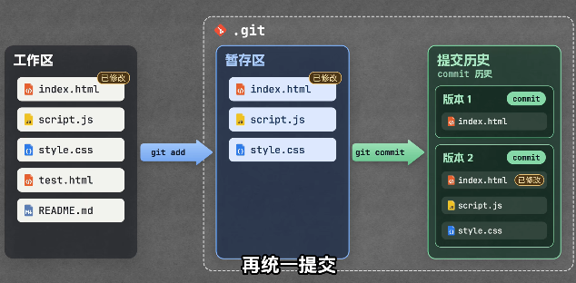
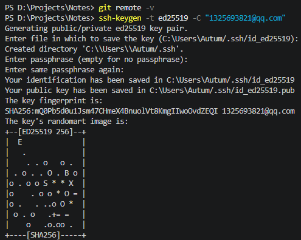
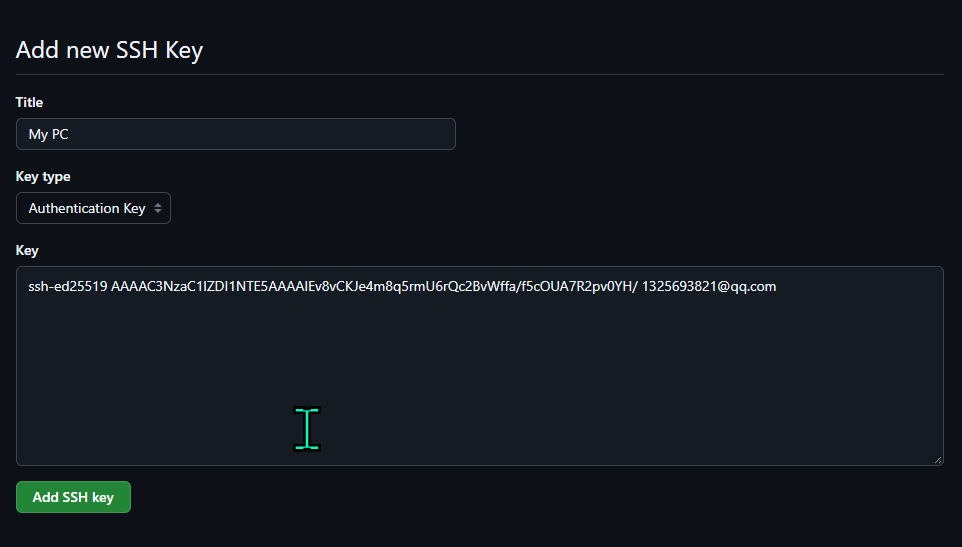
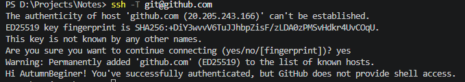

# Week 1 · Git 学习笔记

> **仓库路径**：`D:\Projects\Notes`
> **图片存放**：`./assets/`（相对路径引用，推送后不丢失）

------

## 目录

- [Day 1 · Git 安装与首次 commit](#day-1--git-安装与首次-commit)
  - [1. 环境准备](#1-环境准备)
  - [2. 核心命令速查](#2-核心命令速查)
  - [3. 三板斧：add → commit → log](#3-三板斧add--commit--log)
  - [4. Git 仓库的三个区域（核心概念）](#4-git-仓库的三个区域核心概念)
  - [5. 首次提交全流程详解](#5-首次提交全流程详解)
  - [6. Day 1 · 三个关键问题总结](#6-day-1--三个关键问题总结)
- [补充：命令行环境对比](#补充命令行环境对比)
  - [Cmd vs PowerShell](#cmd-vs-powershell)
  - [VS Code 集成终端](#vs-code-集成终端)
  - [Bash 语言简介](#bash-语言简介)
- [Day 2 · 推送 GitHub](#day-2--推送-github)
  - [1. commit 信息规范](#1-commit-信息规范)
  - [2. SSH 配置（推荐方案）](#2-ssh-配置推荐方案)
  - [3. 关联远程仓库](#3-关联远程仓库)
  - [4. 推送操作详解](#4-推送操作详解)
  - [5. 关键概念澄清](#5-关键概念澄清)

------

## Day 1 · Git 安装与首次 commit

### 1. 环境准备

#### 查看版本，确认安装成功

```bash
git --version
```

#### 建立目录 + 初始化仓库

```bash
mkdir Notes
cd Notes
git init
```

> **注意**：`git init` 会在目录里生成一个名为 `.git` 的隐藏文件夹（名字前面带一个英文句点）。它是整个仓库的核心，所有版本数据都存在这里。Windows 资源管理器默认不显示隐藏文件夹，需用 PowerShell 的 `ls -Force` 或开启"显示隐藏文件"才能看到。

#### 用 .md 文件记录笔记

初始化仓库后，可以在该目录里新建一个以 `.md` 结尾的文件（Markdown 格式）来记笔记，例如本次的 `W1-Git笔记.md`。Markdown 用 `#` 分级标题、用反引号包裹代码，VSCode 可直接预览。

------

### 2. 核心命令速查

| 命令                   | 作用                                        |
| ---------------------- | ------------------------------------------- |
| `git init`             | 把普通文件夹变成 Git 仓库                   |
| `git add`              | 把文件放进暂存区，告诉 Git "这个文件要存档" |
| `git commit -m "说明"` | 把暂存区的内容正式打包，生成一条提交记录    |
| `git log`              | 查看提交历史                                |

------

### 3. 三板斧：add → commit → log

```bash
git add W1-Git笔记.md
git commit -m "W1 Git笔记 | 首次提交"
git log
```

> **规律**：新增或修改内容后，重复上述过程即可。改一次 → add → commit，攒出一条条历史记录。

------

### 4. Git 仓库的三个区域（核心概念）

Git 仓库分为 **工作区、暂存区、版本库** 三部分：



1. **左侧「工作区」**：你日常编辑的所有文件都在这里（如 index.html、script.js、style.css 等）。其中标了"已修改"的文件，说明你改过它但还没提交。
2. **`git add` 的作用——选择性挑选**：注意 `git add` 箭头指向的暂存区里，只有被挑选的几个文件，其余文件并没有进去。这就是"暂存区是草稿箱"的核心意义：**你只 add 想提交的部分，不是一股脑全交**。
3. **`git commit` 的作用——打包存档**：暂存区里的文件被打包成一个新版本。每一次 commit 都是一次**完整快照**，而不是在原版本上增量追加。

逐条对应：

- **工作区**：类似我们当前的项目文件夹，是你日常编辑文件的地方。
- **暂存区**：执行 `git add` 后文件进入的区域，相当于"准备提交的草稿箱"。
- **版本库**：执行 `git commit` 后的内容正式存档的位置，里面保存着所有的**提交历史**。

> **重要辨析**：截图里暂存区画成了一个**带边框的独立框**，容易让人误以为它是某个真实的文件夹。实际上暂存区**不是一个你可以打开的文件夹**，它是 `.git` 内部维护的一张"清单表"（叫 `index` 文件），记录"哪些文件的哪些改动被我选中了"。你不需要找到它，只需要记住 `git add` 就是把文件信息登记到这张表里。

当项目里有多个文件时，用 `git add` 把需要提交的文件放进暂存区；等暂存区的文件全部整理好，再用 `git commit` 统一提交，作为一个修改的整体版本。

------

### 5. 首次提交全流程详解

#### 状态检查：待提交文件已进入暂存区


执行 `git add .\W1-Git笔记.md` 后跑一次 `git status`，输出类似：

```text
On branch main

No commits yet

Changes to be committed:
  (use "git rm --cached <file>..." to unstage)
        new file:   "W1-Git\347\254\224\350\256\260.md"
```

**从这段输出能读出 4 件事：**

1. `On branch main` → 当前在 `main` 分支。
2. `No commits yet` → **这个仓库还从未提交过**，这是第一条 commit 之前特有的提示。以后再跑 `git status` 就不会有这行了。
3. `Changes to be committed` → 文件已经成功进入暂存区，下一步可以 commit。
4. `new file: "W1-Git\347\254..."` → 这是 `W1-Git笔记.md` 的 UTF-8 字节编码显示（`\347\254...` 就是"笔记"二字的字节序列），说明 Git 识别到它是一个**全新的文件**（之前从未被跟踪过）。

> **关键区别**：以后修改已有文件再 add，这里会显示 `modified:` 而不是 `new file:`。`new file` 只出现在文件第一次被 add 时。

#### 配置提交身份（用户名 + 邮箱）


提交前告诉 Git 自己的用户名和邮箱，供 commit 时记录作者。**Git 不做真实性校验**，只是把它写进提交记录里。

```bash
git config --global user.name "AutumnBeginer"
git config --global user.email "1325693821@qq.com"
```

配完后可以用下面的命令验证是否生效：

```bash
git config user.name
git config user.email
```

应输出 `AutumnBeginer` 和 `1325693821@qq.com`。

> 说明一：带 `--global` 的配置是**一次性**的，写好之后对所有仓库生效，并不是每次提交前都要重新配置。第一次用 Git 时配好即可。
> 说明二：`git config --global ...` 执行后**没有任何终端输出是正常的**，Git 不会告诉你"配置成功"，只要没报错就说明写进去了。

#### 执行提交


使用 `git commit -m "说明"`，其中 `-m` 代表 message，用来标注这次 commit 做了什么、改了什么，方便日后查看历史。

执行 `git commit -m "第一次笔记"` 后输出：

```text
[main (root-commit) cb9fa9c] 第一次笔记
 1 file changed, 35 insertions(+)
 create mode 100644 "W1-Git\347\254\224\350\256\260.md"
```

**逐行翻译：**

- `[main` → 提交发生在 `main` 分支上
- `(root-commit)` → **这是根提交**，即仓库历史上的第一条 commit。以后再提交就不会有这行标注了
- `cb9fa9c]` → 本次提交 commit hash 的**前 7 位**（完整 hash 是 40 位十六进制字符）。以后回退/撤销时靠这个短 hash 定位具体哪一条
- `第一次笔记` → 你写的 commit message
- `1 file changed` → 本次提交涉及 1 个文件
- `35 insertions(+)` → 共新增了 35 行内容（整篇笔记是新写的，所以全是插入，没有删除）
- `create mode 100644` → Git 记录的文件权限模式，`100644` 表示"普通文件，所有者可读写，其他人只读"，不需要你改，Git 自动处理

> **判断技巧**：看到 `(root-commit)` 说明这是仓库的"第一粒种子"，从 0 到 1 的里程碑。以后的提交只会显示类似 `[main abc1234]`，不再有 `root-commit` 标注。

#### 查看历史


紧接着输入 `git log` 查看 commit 历史，输出：

```text
commit cb9fa9c6e545c2d44a30c7db85321552efea2598 (HEAD -> main)
Author: AutumnBeginer <1325693821@qq.com>
Date:   Mon Oct 12 19:16:05 2026 +0800

    第一次笔记
```

**逐行翻译：**

- `commit cb9fa9c...` → 完整 40 位 hash。上面 commit 输出里看到的 `cb9fa9c` 就是它的前 7 位缩略版
- `(HEAD -> main)` → **HEAD 指向 main 分支**，且 main 分支的"最新位置"就在这条 commit 上。以后 commit 越多，HEAD 会跟着最新的 commit 一起往前走
- `Author: AutumnBeginer <1325693821@qq.com>` → **证明身份配置生效了**。如果这里是旧用户名/邮箱，说明 `git config` 没配对
- `Date: Mon Oct 12 19:16:05 2026 +0800` → 提交时间，`+0800` 表示东八区（北京时间）
- 缩进的 `第一次笔记` → commit message

> **对比验证**：把这里的 Author 邮箱和 `git config user.email` 的输出对照，一致就说明 Day 1 的身份配置彻底成功了，以后每次 commit 都会带上这个身份。

------

### 6. Day 1 · 三个关键问题总结

#### 1. 仓库到底是个什么东西

**一句话**：普通文件夹变成"仓库"，就是因为它里面多了一个 `.git` 文件夹。`.git` 就是 Git 的"大脑 + 档案柜"，所有版本信息都存在它里面，而不是存在笔记文件里。

**凭什么它一出现就变成仓库了？** 因为 Git 判断"当前目录是不是仓库"，靠的就是**向上找 `.git`**：

- `git init` 干的事，本质就是在当前目录**造一个 `.git` 文件夹**，里面预先放好了空的档案结构（分支指针、对象库、配置等）。
- 此后任何 `git` 命令，都会先在当前目录找 `.git`，找不到就一层层往父目录找，找到就用它。

这正好解释了第 1 轮踩的坑：在 `learning-log` 里敲 `git status`，却看到 `..test01.py` 这些路径——那是因为 `learning-log` 自己**没有** `.git`，Git 往上找到了 `D:\Projects\.git`，于是把你当成了那个大仓库里的一员。删掉父目录的 `.git`、在 `Notes` 里重新 `git init`，`Notes` 才第一次拥有了属于自己的 `.git`，从此独立。

> 所以"仓库 = 一个带 `.git` 的普通文件夹"。`.git` 是隐藏的，是因为它是给机器看的内部档案，平时不该误碰。

#### 2. add / commit 各自在干嘛，为什么要中间夹一个暂存区

**三层流动关系**（记住这个方向就够）：

```text
工作区  --git add-->  暂存区  --git commit-->  本地仓库
(你正在编辑的)      (草稿箱/待提交清单)       (永久存档，带版本号)
```

- **工作区**：你直接用 VSCode 打开、能看能改的那些文件本身。
- **`git add` 做的事**：把"我这次想把哪些改动纳入下一版"挑选出来，拍个快照放进暂存区。它是**选择性**的动作——你可以只 add 一部分文件。
- **`git commit` 做的事**：把暂存区里这一堆东西**打包成一条永久记录**，生成一个 commit（带唯一 hash、作者、时间、说明）。commit 之后这条记录就再也动不了了，要改只能再提新的。

**为什么非要有暂存区，直接提交不行吗？** 这是 Git 设计上很聪明的一点，核心目的是**让你能"攒一批相关改动，一次提交"**：

- 假设你同时改了 3 件事：修了笔记错别字、补了一段命令解释、又顺手调了图片路径。如果"改完即提交"，这 3 件事会被迫挤进同一条 commit，历史会糊成一团，以后想回退某一件都做不到。
- 有了暂存区，你可以**先只 add 错别字那部分 → commit 一条**；再 add 命令解释 → 再 commit 一条。每次提交都是"一个干净、自洽的小单元"。
- 也就是说：**暂存区是"提交前的取景框"**，让你决定"这一版到底包含什么"，而不是工作区里乱七八糟改动的全量快照。

> 一个帮助理解的比喻：工作区是你的"书桌"（东西摊得到处都是），暂存区是你"决定要交上去的那一摞纸"，commit 是"盖了日期章正式归档的那一份"。你不必把整张书桌都归档，只交那一摞。

#### 3. git status 为什么值得随时敲

**一句话**：`git status` 是 Git 的"体检报告 / GPS 定位"——它不改变任何东西，只回答一个问题：**我现在到底站在哪、手上有哪些活儿没处理完。**

跑一次它，你能从输出里读出这几件事：

1. **当前在哪个分支**（`On branch main`）。以后开分支干活时，这条尤其重要，能防止"以为在 A 分支其实还在 main 上乱改"。
2. **哪些文件被改动、但还没进暂存区**（"Changes not staged for commit"）→ 提示你该 `git add` 了。
3. **哪些文件已经进了暂存区、等着被提交**（"Changes to be committed"）→ 提示你 `git commit` 会把它们打包走。
4. **哪些是全新、Git 还没开始跟踪的文件**（"Untracked files"）→ 比如刚在 VSCode 新建但没保存/没 add 的笔记。"建了文件 git status 看不到"的困惑，本质就是这一栏：要么没保存，要么没 add。
5. （冲突时）哪些文件**有冲突需要你手动解决**。

**为什么"值得随时敲"？** 因为它是你判断"下一步该敲什么命令"的依据，而不是凭记忆瞎猜：

- 看到 `Untracked` → 该 `git add`；
- 看到 `not staged` → 改动还没被纳入本次提交，要不要 add；
- 看到 `to be committed` → 可以直接 `git commit` 了；
- 什么都没有、显示 `nothing to commit, working tree clean` → 说明改动已经全部安全存档，可以放心干下一件事。

------

## 补充：命令行环境对比

### Cmd vs PowerShell

| 对比维度     | Cmd（命令提示符）                      | PowerShell                                                   |
| ------------ | -------------------------------------- | ------------------------------------------------------------ |
| **底层**     | 传统命令行，基于 DOS，处理纯文本       | 基于 .NET 框架，处理结构化对象                               |
| **命令风格** | 少量固定命令（dir、cd、copy）          | 动词-名词命名（Get-ChildItem），命令丰富且可扩展，兼容多数 Cmd 命令作别名 |
| **管道**     | 传递文本，后续命令需自行解析           | 传递对象，可直接访问属性/方法，无需解析                      |
| **脚本能力** | 批处理（.bat）功能简单，缺现代编程特性 | 完整编程语言（函数、类、异常、模块），适合复杂自动化         |
| **管理范围** | 文件系统及基本操作                     | 全 Windows 生态（注册表、服务、IIS、Azure 等），可通过模块扩展 |
| **适用场景** | 日常简单操作（查看目录、复制文件）     | 系统管理、批量运维、脚本自动化                               |

> **简单选**：轻量操作用 Cmd，复杂自动化用 PowerShell。

### VS Code 集成终端

**本质**：VS Code 内嵌的系统 shell 界面（非独立 shell），实际运行的是系统已安装的 shell（如 PowerShell、Cmd、Git Bash、WSL 等）。

**特点**：

- 与编辑器同窗口，免切换
- 默认从当前项目根目录启动
- 可与任务、调试、Git、扩展联动
- 支持多标签（同时开不同 shell）

**如何打开**：

- 快捷键：`` Ctrl + ` ``（反引号）
- 新建终端：`Ctrl+Shift+`（Mac 为 `Cmd+Shift+`）
- 菜单：查看 → 终端

**修改默认 shell**：

1. 命令面板法：`Ctrl+Shift+P` → `Terminal: Select Default Profile` → 选所需 shell

2. 设置法（settings.json）：

   ```json
   "terminal.integrated.profiles.windows": {
     "Command Prompt": { "path": "..." },
     "PowerShell": { "path": "..." }
   },
   "terminal.integrated.defaultProfile.windows": "Command Prompt"
   ```

   可针对工作区单独配置。

**注意事项**：

- 集成终端权限继承 VS Code，如需管理员权限需另开外部终端或使用 `runas`
- 若终端闪退，检查 shell 是否安装、启动目录是否存在、启动脚本是否有误

### Bash 语言简介

Bash 是 Linux/macOS 下的"命令行母语"，擅长用简洁的文本流管道完成系统管理和自动化任务。在 Windows 上可通过 WSL 或 Git Bash 获得类似的体验。

------

## Day 2 · 推送 GitHub

### 1. commit 信息规范

commit 信息为什么要写成 `W1 主题 | 进度` 这种格式？这不是 Git 的语法要求——`git commit -m "随便写点啥"` 也能提交成功。它图的是**人**，不是机器。核心目的有三个：

**① 让 `git log` 一眼能扫。** 以后笔记越记越多、commit 几十条时，`git log` 是一长串列表。有统一格式的话，眼睛能立刻按"周次 / 主题"定位：

```text
W1 Git笔记 | 首次提交
W1 Git笔记 | 补充踩坑记录
W1 Git笔记 | Day1 通关
W2 分支 | 学会开 feature 分支
```

没有格式的话就是"改了一下""又改了""test"——回头你自己都认不出哪条是哪条。

**② `|` 把"定位"和"内容"分开。**

- 竖线左边 `W1 Git笔记`：**这是什么**（周期 + 文件/主题），相当于"文件名 + 章节"。
- 竖线右边 `补充踩坑记录`：**这次具体干了啥**，一句话描述这次改动的动作。

这样切分后，左边保持稳定（同一篇笔记的 commit 前缀都一样），右边每次都不同，`git log` 里就能看出"同一主题下我推进了哪几步"。

**③ 方便日后回退/筛选。** Day 4 要学"回退与撤销"，那时需要从历史里精确挑出某一条 commit。信息规范时，可以用关键词搜：

```bash
git log --grep="补充踩坑"
```

乱写就搜不到。

> 一句话：commit 信息是写**给未来的自己和同事看的日志标题**，不是写给 Git 解析的。固定成 `范围 | 动作`，就是为了让历史记录像目录一样可扫、可搜、可回退。

### 2. SSH 配置（推荐方案）

**为什么选 SSH？** 配一次密钥，后续所有 `git push`、`git pull` 都不需要再输任何密码或 token，且比 HTTPS 更安全（私钥留在本地，公钥交给 GitHub）。绝大多数开源项目和专业开发者都默认使用 SSH。

#### 第一步：生成 SSH 密钥

打开 **Git Bash**（或 VS Code 终端，确保是 Git Bash 而非 cmd/PowerShell），执行：

```bash
ssh-keygen -t ed25519 -C "你的GitHub邮箱"
```

- 第一个回车：接受默认保存路径 `C:\Users\你的用户名\.ssh\id_ed25519`
- 第二、三个回车：密码短语留空（避免每次使用都要输密码）
- 完成后会显示指纹和随机图案，暂时不必深究

生成的两个文件：

- `id_ed25519` —— **私钥**，绝不可泄露
- `id_ed25519.pub` —— **公钥**，需要添加到 GitHub



#### 第二步：将公钥添加到 GitHub

1. 用记事本打开 `id_ed25519.pub`，全选复制里面的内容。
2. 浏览器登录 GitHub，点击右上角头像 → **Settings**。
3. 左侧菜单选择 **SSH and GPG keys** → **New SSH key**。
4. Title 任意填写（如 `My PC`），Key 粘贴刚才复制的内容 → **Add SSH key**。



#### 第三步：测试连接

终端执行：

```bash
ssh -T git@github.com
```

第一次会提示 `Are you sure you want to continue connecting?`，输入 `yes` 回车。看到类似以下输出即成功：

```text
Hi 你的用户名! You've successfully authenticated, but GitHub does not provide shell access.
```



### 3. 关联远程仓库

在 GitHub 上**建一个空的远程仓库**（不要勾选 README、.gitignore 或 license，保持全空，否则首次推送会和本地冲突）。

创建成功后，页面会显示推送指南。因为我们选择 SSH，所以复制 SSH 格式的地址：`git@github.com:AutumnBeginer/Notes.git`

在本地 `Notes` 目录的终端中执行：

```bash
git remote add origin git@github.com:AutumnBeginer/Notes.git
```

**这条命令做了什么？** 把远程仓库地址 `git@github.com:AutumnBeginer/Notes.git` 起了一个别名 `origin`，并将本地仓库与这个远程地址关联起来。以后 `origin` 就代表这个远程仓库。

> **如果之前已经关联过 `origin`**（例如先用 HTTPS 试过），再次执行 `git remote add` 会报错 `error: remote origin already exists`。此时应改用 `set-url` 修改地址：
>
> ```bash
> git remote set-url origin git@github.com:AutumnBeginer/Notes.git
> ```

验证关联是否成功：

```bash
git remote -v
```

输出应显示两行（fetch 和 push），均指向你的 SSH 地址，如下图：


### 4. 推送操作详解

#### 确认当前分支名

执行 `git status`，观察第一行。如果显示 `On branch main`，则无需重命名；如果显示 `On branch master`，则需要执行：

```bash
git branch -M main
```

`-M` 是强制重命名，将 `master` 改为 `main`（GitHub 推荐的默认主分支名）。

#### 首次推送（带 `-u`）

```bash
git push -u origin main
```

**`-u` 是什么？** 是 `--set-upstream` 的缩写，作用：**把"本地 main 分支"和"远程 origin 的 main 分支"绑成默认搭档**。

- 这条命令干了两件事：① 把代码推上去；② **记住**"以后我在本地 main 上，push/pull 默认就对着 origin 的 main"。
- 之后推送就可以直接用 `git push` 和 `git pull`，无需再加参数。

**如果没有 `-u` 会怎样？** 每次推送都必须写全 `git push origin main`，且首次 `git pull` 会提示"指定要合并哪个远程分支"。

> 一句话：`-u` 是"**首次推送时顺便认个干亲**"，绑好之后 push/pull 就能省掉后面那串参数。Day 2 第一次推送，务必带上 `-u`。

#### 完整操作流程（从修改笔记到推送到 GitHub）

```bash
# 1. 将所有改动加入暂存区
git add .

# 2. 提交到本地仓库（生成一个本地版本）
git commit -m "W1 GitHub远程 | 完成笔记更新"

# 3. 推送到 GitHub（将本地版本上传到云端）
git push -u origin main
```

**关键理解**：

- `git add` 和 `git commit` 是**完全在本地执行**的操作，与网络无关，即使断网也能执行。
- `git push` 是**唯一涉及网络传输**的命令，它将本地已提交的 commit 上传到远程仓库。

### 5. 关键概念澄清

#### origin 是什么？

`origin` 是远程仓库的**默认别名（小名）**。

- **为什么叫 origin？** 英文意思是"源头、起源"。从 GitHub 克隆仓库时，Git 会自动把这个远程仓库的名字设为 `origin`。它是一个约定俗成的名称。
- **它的作用是什么？** 为了偷懒和省事。没有别名时每次推送都要输完整地址，有了 `origin` 只需写 `git push origin main`。
- **必须叫 origin 吗？** 不是必须的，你可以改成任何名字（如 `github`、`backup`），甚至一个项目可以关联多个远程仓库。但为了和全网教程保持一致，**强烈建议新手就叫 origin**。

#### SSH 认证原理

SSH key 在本地生成，分为私钥和公钥：

- **私钥**存在本地，绝不可泄露。
- **公钥**发给 GitHub。

每次向 GitHub 传输代码时，本地私钥会生成一个验证文件（签名）一并传给 GitHub，GitHub 用公钥验证该签名是否由你的私钥生成，从而确认身份。

#### 推送前后状态变化

- **关联后、推送前**：本地仓库与 GitHub 仓库已建立连接，但代码仍在本地，GitHub 上仍是空仓库。
- **推送后**：本地所有已提交的 commit 被上传到 GitHub，可以在网页上看到文件和历史记录。

------

> **Day 2 完成标志**：刷新 GitHub 仓库页面，能看到你的笔记文件和 commit 记录。以后每次修改只需 `git add` → `git commit` → `git push` 即可同步到云端。