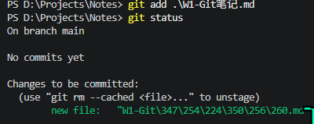
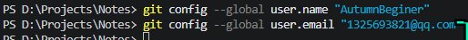
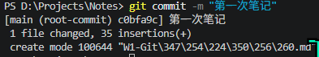
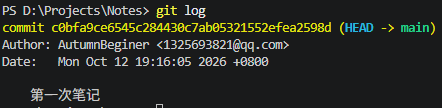

# Week 1 · Git 学习笔记

> 本仓库路径：`D:\Projects\Notes`
> 图片统一存放于仓库内 `./assets/` 目录（用相对路径引用，保证 push 到 GitHub 后图片不丢失）

------

## Day 1 · Git 安装与首次 commit

### 1. 查看版本，确认安装成功

```bash
git --version
```

### 2. 建立目录 + 初始化仓库

```bash
mkdir Notes
cd Notes
git init
```

**注意：** `git init` 会在目录里生成一个名为 `.git` 的隐藏文件夹（名字前面带一个英文句点）。它是整个仓库的核心，所有版本数据都存在这里。Windows 资源管理器默认不显示隐藏文件夹，需用 PowerShell 的 `ls -Force` 或开启"显示隐藏文件"才能看到。

### 3. 用 .md 文件记录笔记

初始化仓库后，可以在该目录里新建一个以 `.md` 结尾的文件（Markdown 格式）来记笔记，例如本次的 `W1-Git笔记.md`。Markdown 用 `#` 分级标题、用反引号包裹代码，VSCode 可直接预览。

------

## 核心命令含义

| 命令                   | 作用                                        |
| ---------------------- | ------------------------------------------- |
| `git init`             | 把普通文件夹变成 Git 仓库                   |
| `git add`              | 把文件放进暂存区，告诉 Git "这个文件要存档" |
| `git commit -m "说明"` | 把暂存区的内容正式打包，生成一条提交记录    |
| `git log`              | 查看提交历史                                |

------

## 三板斧：add → commit → log

```bash
git add W1-Git笔记.md
git commit -m "W1 Git笔记 | 首次提交"
git log
```

**新增或修改内容后，重复上一过程即可。**（改一次 → add → commit，攒出一条条历史记录）

------

## Git 知识：仓库的三个区域

Git 仓库分为 **工作区、暂存区、版本库** 三部分：


1. **左侧「工作区」**：你日常编辑的所有文件都在这里（如 index.html、script.js、style.css 等）。其中标了"已修改"的文件，说明你改过它但还没提交。
2. **`git add` 的作用——选择性挑选**：注意 `git add` 箭头指向的暂存区里，只有被挑选的几个文件，其余文件并没有进去。这就是"暂存区是草稿箱"的核心意义：**你只 add 想提交的部分，不是一股脑全交**。
3. **`git commit` 的作用——打包存档**：暂存区里的文件被打包成一个新版本。每一次 commit 都是一次**完整快照**，而不是在原版本上增量追加。

逐条对应：

- **工作区**：类似我们当前的项目文件夹，是你日常编辑文件的地方。
- **暂存区**：执行 `git add` 后文件进入的区域，相当于"准备提交的草稿箱"。
- **版本库**：执行 `git commit` 后的内容正式存档的位置，里面保存着所有的**提交历史**。

> **重要辨析**：截图里暂存区画成了一个**带边框的独立框**，容易让人误以为它是某个真实的文件夹。实际上暂存区**不是一个你可以打开的文件夹**，它是 `.git` 内部维护的一张"清单表"（叫 `index` 文件），记录"哪些文件的哪些改动被我选中了"。你不需要找到它，只需要记住 `git add` 就是把文件信息登记到这张表里。

当项目里有多个文件时，用 `git add` 把需要提交的文件放进暂存区；等暂存区的文件全部整理好，再用 `git commit` 统一提交，作为一个修改的整体版本。

------

## 提交过程图解

### 状态检查：待提交文件已进入暂存区



执行 `git add .\W1-Git笔记.md` 后跑一次 `git status`，输出类似：

```text
On branch main

No commits yet

Changes to be committed:
  (use "git rm --cached <file>..." to unstage)
        new file:   "W1-Git\347\254\224\350\256\260.md"
```

**从这段输出能读出 4 件事：**

1. `On branch main` → 当前在 `main` 分支。
2. `No commits yet` → **这个仓库还从未提交过**，这是第一条 commit 之前特有的提示。以后再跑 `git status` 就不会有这行了。
3. `Changes to be committed` → 文件已经成功进入暂存区，下一步可以 commit。
4. `new file: "W1-Git\347\254..."` → 这是 `W1-Git笔记.md` 的 UTF-8 字节编码显示（`\347\254...` 就是"笔记"二字的字节序列），说明 Git 识别到它是一个**全新的文件**（之前从未被跟踪过）。

> **关键区别**：以后修改已有文件再 add，这里会显示 `modified:` 而不是 `new file:`。`new file` 只出现在文件第一次被 add 时。

### 配置提交身份（用户名 + 邮箱）



提交前告诉 Git 自己的用户名和邮箱，供 commit 时记录作者。**Git 不做真实性校验**，只是把它写进提交记录里。

```bash
git config --global user.name "AutumnBeginer"
git config --global user.email "1325693821@qq.com"
```

配完后可以用下面的命令验证是否生效：

```bash
git config user.name
git config user.email
```

应输出 `AutumnBeginer` 和 `1325693821@qq.com`。

> 说明一：带 `--global` 的配置是**一次性**的，写好之后对所有仓库生效，并不是每次提交前都要重新配置。第一次用 Git 时配好即可。
> 说明二：`git config --global ...` 执行后**没有任何终端输出是正常的**，Git 不会告诉你"配置成功"，只要没报错就说明写进去了。

### 执行提交



使用 `git commit -m "说明"`，其中 `-m` 代表 message，用来标注这次 commit 做了什么、改了什么，方便日后查看历史。

执行 `git commit -m "第一次笔记"` 后输出：

```text
[main (root-commit) cb9fa9c] 第一次笔记
 1 file changed, 35 insertions(+)
 create mode 100644 "W1-Git\347\254\224\350\256\260.md"
```

**逐行翻译：**

- `[main` → 提交发生在 `main` 分支上
- `(root-commit)` → **这是根提交**，即仓库历史上的第一条 commit。以后再提交就不会有这行标注了
- `cb9fa9c]` → 本次提交 commit hash 的**前 7 位**（完整 hash 是 40 位十六进制字符）。以后回退/撤销时靠这个短 hash 定位具体哪一条
- `第一次笔记` → 你写的 commit message
- `1 file changed` → 本次提交涉及 1 个文件
- `35 insertions(+)` → 共新增了 35 行内容（整篇笔记是新写的，所以全是插入，没有删除）
- `create mode 100644` → Git 记录的文件权限模式，`100644` 表示"普通文件，所有者可读写，其他人只读"，不需要你改，Git 自动处理

> **判断技巧**：看到 `(root-commit)` 说明这是仓库的"第一粒种子"，从 0 到 1 的里程碑。以后的提交只会显示类似 `[main abc1234]`，不再有 `root-commit` 标注。

### 查看历史



紧接着输入 `git log` 查看 commit 历史，输出：

```text
commit cb9fa9c6e545c2d44a30c7db85321552efea2598 (HEAD -> main)
Author: AutumnBeginer <1325693821@qq.com>
Date:   Mon Oct 12 19:16:05 2026 +0800

    第一次笔记
```

**逐行翻译：**

- `commit cb9fa9c...` → 完整 40 位 hash。上面 commit 输出里看到的 `cb9fa9c` 就是它的前 7 位缩略版
- `(HEAD -> main)` → **HEAD 指向 main 分支**，且 main 分支的"最新位置"就在这条 commit 上。以后 commit 越多，HEAD 会跟着最新的 commit 一起往前走
- `Author: AutumnBeginer <1325693821@qq.com>` → **证明身份配置生效了**。如果这里是旧用户名/邮箱，说明 `git config` 没配对
- `Date: Mon Oct 12 19:16:05 2026 +0800` → 提交时间，`+0800` 表示东八区（北京时间）
- 缩进的 `第一次笔记` → commit message

> **对比验证**：把这里的 Author 邮箱和 `git config user.email` 的输出对照，一致就说明 Day 1 的身份配置彻底成功了，以后每次 commit 都会带上这个身份。

------

## Day 1 · 三个问题总结

### 1. 仓库到底是个什么东西

**一句话**：普通文件夹变成"仓库"，就是因为它里面多了一个 `.git` 文件夹。`.git` 就是 Git 的"大脑 + 档案柜"，所有版本信息都存在它里面，而不是存在笔记文件里。

**凭什么它一出现就变成仓库了？** 因为 Git 判断"当前目录是不是仓库"，靠的就是**向上找 `.git`**：

- `git init` 干的事，本质就是在当前目录**造一个 `.git` 文件夹**，里面预先放好了空的档案结构（分支指针、对象库、配置等）。
- 此后任何 `git` 命令，都会先在当前目录找 `.git`，找不到就一层层往父目录找，找到就用它。

这正好解释了第 1 轮踩的坑：在 `learning-log` 里敲 `git status`，却看到 `..test01.py` 这些路径——那是因为 `learning-log` 自己**没有** `.git`，Git 往上找到了 `D:\Projects\.git`，于是把你当成了那个大仓库里的一员。删掉父目录的 `.git`、在 `Notes` 里重新 `git init`，`Notes` 才第一次拥有了属于自己的 `.git`，从此独立。

> 所以"仓库 = 一个带 `.git` 的普通文件夹"。`.git` 是隐藏的，是因为它是给机器看的内部档案，平时不该误碰。

### 2. add / commit 各自在干嘛，为什么要中间夹一个暂存区

**三层流动关系**（记住这个方向就够）：

```text
工作区  --git add-->  暂存区  --git commit-->  本地仓库
(你正在编辑的)      (草稿箱/待提交清单)       (永久存档，带版本号)
```

- **工作区**：你直接用 VSCode 打开、能看能改的那些文件本身。
- **`git add` 做的事**：把"我这次想把哪些改动纳入下一版"挑选出来，拍个快照放进暂存区。它是**选择性**的动作——你可以只 add 一部分文件。
- **`git commit` 做的事**：把暂存区里这一堆东西**打包成一条永久记录**，生成一个 commit（带唯一 hash、作者、时间、说明）。commit 之后这条记录就再也动不了了，要改只能再提新的。

**为什么非要有暂存区，直接提交不行吗？** 这是 Git 设计上很聪明的一点，核心目的是**让你能"攒一批相关改动，一次提交"**：

- 假设你同时改了 3 件事：修了笔记错别字、补了一段命令解释、又顺手调了图片路径。如果"改完即提交"，这 3 件事会被迫挤进同一条 commit，历史会糊成一团，以后想回退某一件都做不到。
- 有了暂存区，你可以**先只 add 错别字那部分 → commit 一条**；再 add 命令解释 → 再 commit 一条。每次提交都是"一个干净、自洽的小单元"。
- 也就是说：**暂存区是"提交前的取景框"**，让你决定"这一版到底包含什么"，而不是工作区里乱七八糟改动的全量快照。

> 一个帮助理解的比喻：工作区是你的"书桌"（东西摊得到处都是），暂存区是你"决定要交上去的那一摞纸"，commit 是"盖了日期章正式归档的那一份"。你不必把整张书桌都归档，只交那一摞。

### 3. git status 为什么值得随时敲

**一句话**：`git status` 是 Git 的"体检报告 / GPS 定位"——它不改变任何东西，只回答一个问题：**我现在到底站在哪、手上有哪些活儿没处理完。**

跑一次它，你能从输出里读出这几件事：

1. **当前在哪个分支**（`On branch main`）。以后开分支干活时，这条尤其重要，能防止"以为在 A 分支其实还在 main 上乱改"。
2. **哪些文件被改动、但还没进暂存区**（"Changes not staged for commit"）→ 提示你该 `git add` 了。
3. **哪些文件已经进了暂存区、等着被提交**（"Changes to be committed"）→ 提示你 `git commit` 会把它们打包走。
4. **哪些是全新、Git 还没开始跟踪的文件**（"Untracked files"）→ 比如刚在 VSCode 新建但没保存/没 add 的笔记。"建了文件 git status 看不到"的困惑，本质就是这一栏：要么没保存，要么没 add。
5. （冲突时）哪些文件**有冲突需要你手动解决**。

**为什么"值得随时敲"？** 因为它是你判断"下一步该敲什么命令"的依据，而不是凭记忆瞎猜：

- 看到 `Untracked` → 该 `git add`；
- 看到 `not staged` → 改动还没被纳入本次提交，要不要 add；
- 看到 `to be committed` → 可以直接 `git commit` 了；
- 什么都没有、显示 `nothing to commit, working tree clean` → 说明改动已经全部安全存档，可以放心干下一件事。

------

## Day 2 · 推送 GitHub（三个预习问题）

### 1. `origin` 是什么名字？谁规定的必须叫这个？

**结论先行**：`origin` 只是一个**默认的名字**，不是硬性规定，你完全可以叫别的。

**它到底代表什么？** 远程仓库（就是你 GitHub 上那个仓库）的网址很长，比如：

```text
https://github.com/AutumnBeginer/notes.git
```

每次推送都要敲这么一串太麻烦，Git 就允许你给这个网址**起一个别名**，以后用别名代替整串 URL。这个别名默认就叫 `origin`，意思是"**源头**"——即"代码最终汇聚的那台机器上的仓库"。

**谁规定的？**

- 是你 `git clone` 或 `git remote add` 时，Git **自动填的默认值**。
- `git remote add origin <网址>` 里的 `origin` 就是**你自己写上去的字符串**，换成 `github`、`remote1` 都行，命令照样能跑：

```bash
git remote add github https://github.com/AutumnBeginer/notes.git
git push github main   # 一样能推
```

**为什么大家都用 origin？** 纯粹是**约定俗成**。团队协作、教程、GitHub 页面给的提示语，全都默认你的远程叫 `origin`。入乡随俗叫 `origin`，以后看别人教程、报错信息才不会对不上号。

> 一句话：`origin` = "GitHub 上那个仓库"的外号，Git 默认帮你起好了，你可以改但不建议改。

### 2. `-u` 在 `git push -u origin main` 里是什么意思？

`-u` 是 `--set-upstream` 的缩写，作用一句话：**把"本地 main 分支"和"远程 origin 的 main 分支"绑成默认搭档**。

**对比一下有没有 `-u` 的区别：**

- **第一次推送（带 `-u`）**：

```bash
git push -u origin main
```

这条命令干了两件事：① 把代码推上去；② **记住**"以后我在本地 main 上，push/pull 默认就对着 origin 的 main"。

- **之后再推送（不用 `-u`，也不用写那么长）**：

```bash
git push
git pull
```

因为搭档已经绑好了，Git 知道该往哪推、从哪拉。

**如果没有 `-u` 会怎样？** 你每次都得把全称写全：

```bash
git push origin main   # 每次都得带 origin main
```

而且首次 `git pull` 可能会报一句提示，让你"指定要合并哪个远程分支"，等于让你补上这层绑定关系。

> 一句话：`-u` 是"**首次推送时顺便认个干亲**"，绑好之后 push/pull 就能省掉后面那串参数。Day 2 第一次推送，务必带上 `-u`。

### 3. commit 信息为什么要写成 `W1 主题 | 进度` 这种格式？

这不是 Git 的语法要求——`git commit -m "随便写点啥"` 也能提交成功。它图的是**人**，不是机器。核心目的有三个：

**① 让 `git log` 一眼能扫。** 以后笔记越记越多、commit 几十条时，`git log` 是一长串列表。有统一格式的话，眼睛能立刻按"周次 / 主题"定位：

```text
W1 Git笔记 | 首次提交
W1 Git笔记 | 补充踩坑记录
W1 Git笔记 | Day1 通关
W2 分支 | 学会开 feature 分支
```

没有格式的话就是"改了一下""又改了""test"——回头你自己都认不出哪条是哪条。

**② `|` 把"定位"和"内容"分开。**

- 竖线左边 `W1 Git笔记`：**这是什么**（周期 + 文件/主题），相当于"文件名 + 章节"。
- 竖线右边 `补充踩坑记录`：**这次具体干了啥**，一句话描述这次改动的动作。

这样切分后，左边保持稳定（同一篇笔记的 commit 前缀都一样），右边每次都不同，`git log` 里就能看出"同一主题下我推进了哪几步"。

**③ 方便日后回退/筛选。** Day 4 要学"回退与撤销"，那时需要从历史里精确挑出某一条 commit。信息规范时，可以用关键词搜：

```bash
git log --grep="补充踩坑"
```

乱写就搜不到。

> 一句话：commit 信息是写**给未来的自己和同事看的日志标题**，不是写给 Git 解析的。固定成 `范围 | 动作`，就是为了让历史记录像目录一样可扫、可搜、可回退。

------

**Day 2 之前只要再消化一件事就够了**：先在 GitHub 上**建一个空的远程仓库**（不要勾 README，保持全空，否则首次推送会和本地冲突）。明天第一件事就是把这个空仓库的地址，用 `git remote add origin <地址>` 绑到 `Notes` 上。三个问题里 `origin`、`-u` 到时候会立刻派上用场。